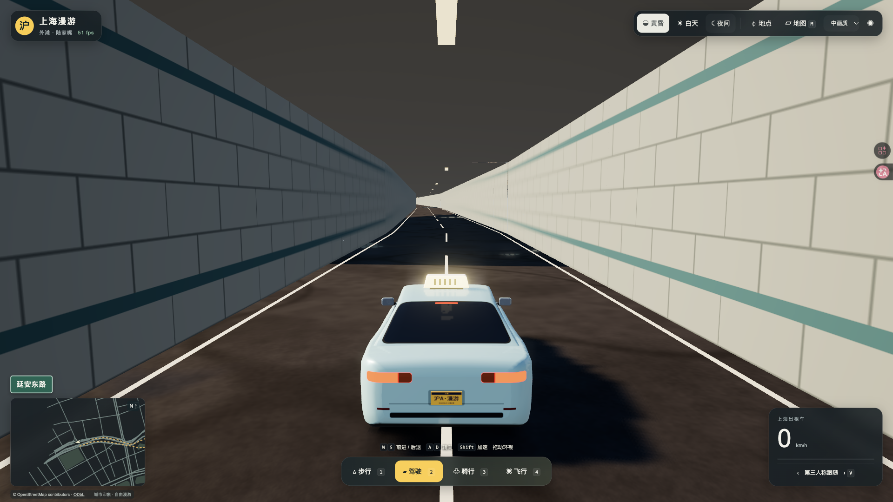

# 上海漫游 · Shanghai Roam

在浏览器里逛一逛上海。沿黄浦江散步，开着出租车穿过街区，骑车看沿路风景，或坐上直升机俯瞰外滩与陆家嘴。

**[在线体验 →](https://shanghai.datiaomao.com/)** · **[原作仓库 →](https://github.com/mrdoob/slop-newyork)** · **[原作在线体验 →](https://mrdoob.github.io/slop-newyork/)**


## 灵感与致谢

这个项目来自 **[mrdoob 的 Slop New York](https://github.com/mrdoob/slop-newyork)**。看到原作可以步行、开车、骑行和驾驶直升机探索纽约后，我想把同样的体验搬到上海。

因此，上海漫游是一次基于原作的**上海复刻与改编**：整体玩法和视觉方向沿用原作，也直接复用了上游的材质、光照、角色与车辆、镜头、行人骨骼和后处理代码。在此基础上，将城市换成上海，接入本地道路与水系数据，制作上海地标，调整中文界面、地图、分块加载和隧道通行等实现。

感谢 Mr.doob 开源这个有趣的项目。原始代码及其 MIT 许可保留在 [`vendor/slop-newyork/`](vendor/slop-newyork/)，具体复用范围与数据来源见 [来源说明](docs/SOURCES.md)。

## 在线体验

已部署，打开 **[shanghai.datiaomao.com](https://shanghai.datiaomao.com/)** 即可游玩，无需安装。

使用支持 WebGPU 的桌面浏览器，通过键盘和鼠标操作。如果画面不够流畅，可以在右上角降低画质。

| 版本 | 范围 |
| --- | --- |
| 在线体验与当前源码 · 0.3.2 | 上海 16 区、1200 米飞行与 410 个地铁站；实际启动进度、地铁线路/区域/类型筛选与选点飞行 |

0.3.2 于 2026 年 10 月 24 日更新至原独立域名，见[本轮发布记录](docs/deployment/2026-10-24-0.3.2/REPORT.md)。0.2.0 的[首次发布记录](docs/publication/2026-10-24/REPORT.md)继续保留。不同区域的建筑细节并不相同，普通楼宇中包含程序生成和视觉估算。

## 怎么玩

这是一个自由探索的城市漫游小游戏。可以从外滩出发看陆家嘴天际线，再切换交通方式，选择自己感兴趣的街区慢慢逛。

| 操作 | 按键或入口 |
| --- | --- |
| 步行 / 驾驶 / 骑行 / 飞行 | `1` / `2` / `3` / `4`，或点击底部按钮 |
| 地面前进 / 后退 | `W` / `S` |
| 转向 | `A` / `D` |
| 加速 | 按住 `Shift` |
| 飞行俯仰 / 偏航 | `W`、`S` / `A`、`D` |
| 飞行上升 / 下降 | `E` / `Q` |
| 环视 | 鼠标拖动 |
| 切换镜头 | `V` |
| 打开或关闭地图 | `M` |
| 搜索与前往地点 | 在地图中搜索，或使用右上角“地点”菜单 |
| 切换白天、黄昏、夜间 | 右上角时段按钮 |
| 关闭地图、地点菜单 / 恢复隐藏界面 | `Esc` |

第一次玩可以试试这三条路线：

- **沿江看地标**：在外滩步行，转动视角看东方明珠、上海中心、环球金融中心与金茂大厦。
- **开车穿江**：从“地点”菜单前往延安东路隧道入口，驾驶汽车穿过隧道，往返浦西与浦东；驶出隧道后再切换其他模式。
- **空中看昼夜**：切换直升机升空，俯瞰街区，再切换白天、黄昏与夜间，比较城市的不同样子。
- **寻找地铁站**：打开地图搜索站名，或在“地点 → M 地铁站查询”选择车站。红色 M 标记对应地铁站，步行可进入带站名灯箱的玻璃门厅。每站制作一个代表入口，部分入口在站点附近估算放置，未制作站台或乘车玩法。

直升机可按 `E` 升至 1200 米，超过上海中心；按 `Q` 下降。地铁数据覆盖上海境内 1–18 号线及浦江线的 410 个独立站名，来源和入口估算见 [地铁与飞行说明](docs/FLIGHT-METRO.md)，实测见 [0.3.1 验收报告](docs/acceptance/0.3.1/REPORT.md)。

0.3.2 的地图默认只展示地标建筑；可按类型、行政区和地铁线路筛选，数字点点击展开。先选择地点，再点击“飞到这里”切换直升机抵达附近空中，或“按当前方式前往”保留交通方式。加载界面显示实际读取量、街区和材质准备数量，首帧就绪后才进入游戏。详见 [本轮说明](docs/LOADING-MAP.md) 与 [0.3.2 验收](docs/acceptance/0.3.2/REPORT.md)。

## 游戏截图

以下为已有版本的实际运行截图；首图及夜景来自 0.2.0，隧道截图来自 0.1.1，用于展示中心城区的画面与玩法。

### 陆家嘴 · 沿江看天际线

东方明珠与陆家嘴高楼沿黄浦江展开。可以在江边看，也可以飞近观察各个地标（见页面首图）。

### 外滩 · 夜间漫游

切换到夜间，从江对岸看外滩的建筑灯光与水面倒影。


### 延安东路隧道 · 驾车过江

驾驶出租车进入隧道，在地面与地下之间连续行驶，体验两岸往返。



## 本地运行

```sh
npm ci
npm run dev
```

打开 [http://127.0.0.1:4186](http://127.0.0.1:4186)。项目使用 Three.js / WebGPU 和 Vite，地图与运行资源由本地静态文件提供。

## 构建与验证

```sh
npm test
npm run build
npm run preview
npm run package:release
npm run package:source
```

生产预览地址 http://127.0.0.1:4187 。静态资源不依赖在线地图 API。
`release/*-source.tar.gz` 为可编辑源码包，包含固定的 Three.js、原站快照、地理源文件、生成器和测试；截图／录像／原始性能数据在工程的 `docs/acceptance/` 单独交付。
源码包复现可运行 `node tools/audit-source.mjs`；它在临时目录安装 npm 依赖、测试、重建数据和网页，逐文件比对构建哈希，完成后删除临时目录。Python 生成数据时使用本工程已锁定依赖的 `.venv`。

## 数据再生成

源快照保存在 data/source。全市扩展使用 2026-10-23 的 OSM France 上海 PBF 及固定行政边界响应；中心城区覆盖层沿用 2026-09-08 的 OpenStreetMap 缓存，镜像仓库 revision 见 data/source/mirror-source.json。
数据和报告工具需要 Python 3.12 或更新版本，依赖版本分别记录在 `requirements.txt` 与 `requirements-report.txt`。

```sh
python3 -m venv .venv
.venv/bin/pip install -r requirements.txt
.venv/bin/python tools/build-data.py
```

生成器使用 Shapely 组装水面、排除道路与公园、生成普通楼宇、拼接隧道和分块。高度缺失与地下高程采用有标记的视觉估算。
全市 PBF 保留源对象 ID、道路方向及层级标签；历史中心城区缓存仅有部分建筑及简化道路，缺失属性已单独标记。外围高架净高、缺失楼高采用视觉估算；未制作洞体的其他地下道路不开放。来源与限制记录在生成数据中，不能用作实际道路导航或测绘资料。

## 来源

- [Slop New York](https://github.com/mrdoob/slop-newyork)：MIT，采用快照 `1f665309d69ec53b5337a4b8625e1abff48a30bb`，原始副本见 `vendor/slop-newyork/`。
- Three.js: 固定 revision 见 vendor/three/UPSTREAM.json，核心与 addons 同一 revision，自托管。
- 地理数据 © OpenStreetMap contributors，ODbL 1.0；源文件、衍生数据和生成方法随源码提供。
- 地标辅助位置：Wikidata CC0 与 OSM 命名轮廓；每个地标保留来源。

全市范围与构建见 [docs/CITYWIDE.md](docs/CITYWIDE.md)，首版核心玩法验收合同保留在 [docs/PLAN.md](docs/PLAN.md)，来源与估算边界见 [docs/SOURCES.md](docs/SOURCES.md)。

[首版历史验收记录](docs/acceptance/REPORT.md)保留在原目录；0.2.0 的截图、录屏、轨迹和原始帧耗时独立保存在 `docs/acceptance/0.2.0/`。[部署说明](docs/deployment.md)说明独立静态包的启动方法。
`tests/browser/` 是本机 Tabbit 验收程序，包含本地工程路径和任务名；移到其他机器时需按所在路径调整。

## 许可

项目代码沿用 [MIT License](LICENSE)，保留上游版权声明。地理数据 © OpenStreetMap contributors，采用 ODbL 1.0；第三方依赖和数据保留各自许可，详见 [数据许可](data/source/DATA-LICENSE.md)。
