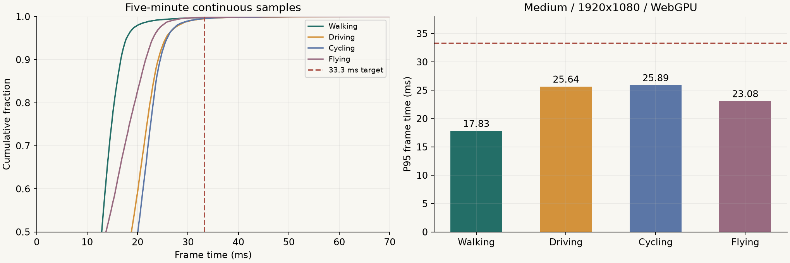
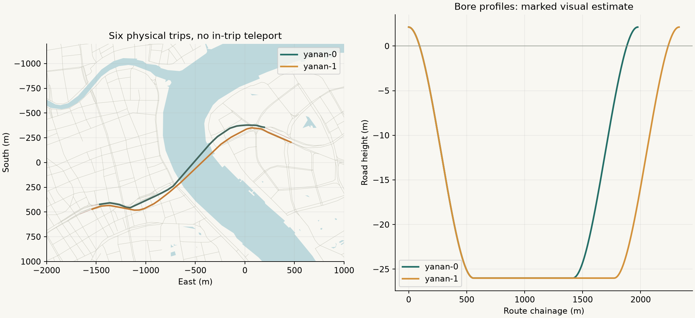
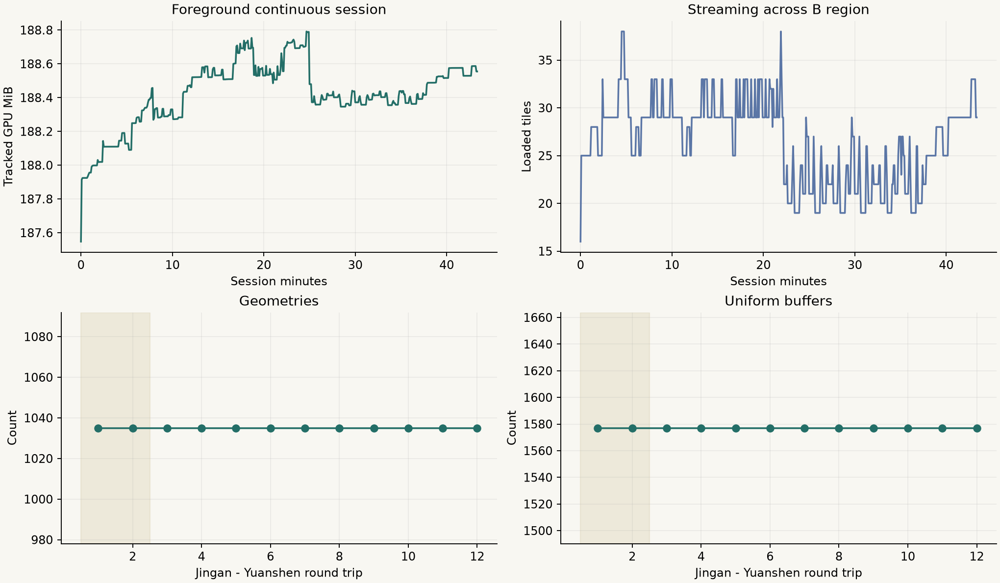
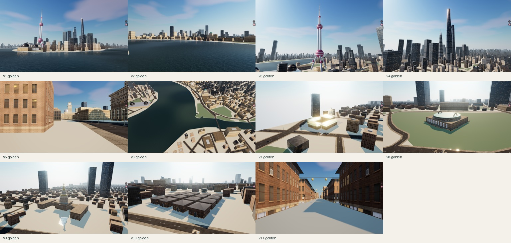

# 上海中心城区 B 档 · 0.2.0 验收报告

已交付68.66km²本地可玩版本、独立静态包与完整源码。保留双向10米游戏洞宽隧道，12个独立地标和7个街区目的地。下列玩法、性能、驾驶、加载和复现技术验证已执行。源道路方向／层级缺失和视觉估算继续明确披露；最终人工美术确认没有替用户判定通过。

## 范围与版本

WGS84边界：`[121.440,31.200,121.540,31.265]`，含水域68.66km²。新增静安寺、南京西路、淮海中路、田子坊、北外滩、南浦大桥地面周边、源深。新增独立外观为静安寺、上海博物馆人民广场馆、上海展览中心、田子坊里弄。南浦大桥桥面驾驶未纳入；跨黄浦江驾驶使用延安东路隧道。

最终脚本：`index-DqNtY0-r.js`；SHA256：`c5eba4464440d161bd4c0dbb0b1e7d48d523f11e0867bede177e5e0fe1047799`。城市数据SHA256：`91f010cc2656aebd7a55e500b5b6f38afd16da68e9cb25f45c3c325d802f4e15`。全部正式模式、驾驶、稳定性及资源回归使用同一脚本。固定源和估算说明见[来源文档](../../SOURCES.md)。

本机Apple M2 Pro／16GB，Tabbit Chromium154.0.8037.58，WebGPU、中档，画布1920×1080，renderer DPR=1。Tabbit90%站点缩放由viewport仿真得到以上真实画布，截图为原生clip。正式帧采样期间无录屏、无视频编码；虚拟手柄控制真实控制器，测试页暂时隔离人工键鼠，结束后恢复。

## 验收结果

| 项目 | 结果与证据 |
|---|---|
| 地理与开放范围 | 4493个地面道路对象，1048个源建筑对象＋22604个程序补体量，320个500米块。不能解释为真实唯一楼栋覆盖率。[范围](../../../data/source/expansion-b.json)、[道路清单](opened-roads.csv) |
| 坐标与洞口 | 32个控制点，独立ECEF→ENU最大转换偏差2.29m，目标≤5m；四个洞口接缝高差0m。这只校验选定源，不证明源地图本身无误差。[控制点](control-points.csv)、[叠合图](geography-overlay.svg)、[审计](geography.json) |
| 地标与碰撞 | 12地标无重复，新增四处具有不同外形；普通楼宇预留排除。新增模型与所有源道路进行全车宽间隔检查，里弄中央通道与展览中心前庭保持可通行。[地标清单](landmarks.csv)、[独立审查与修复](code-review.md) |
| 目的地与界面 | 19目的地全部到达有效、干燥、已加载道路；搜索静安寺／新天地、输入不触发驾驶、晚到请求不覆盖新目标，地图19标记与新边界通过。[交互记录](expansion-interactions.json) |
| 加载异常 | 新区目标失败保持当前位置，重试可达；移动前方未就绪会停止，不进入空场景。加载lease、邻块碰撞halo和路线驻留有自动夹具覆盖。[加载异常](loading-failure.json)、[移动门控](loading-gate.json)、[31项测试](unit-tests.log) |
| 四模式 | 每种模式预热30秒后采样≥300秒，真实移动、停止、相机切换与三时段操作通过。[操作录像](recordings/four-modes-release.mp4)、[操作记录](four-modes-operation.json) |
| 连续双向过江 | 两方向各3次，覆盖白天／黄昏／夜间；六段完整轨迹、原生录屏；黄昏两趟从源地面道路驶入、另一岸驶出，接缝≤0.1m。见下表 |
| 模式性能 | 四种模式P95均≤33.3ms，原始帧和P99完整保留。步行、汽车、骑行走南京西路，飞行覆盖新增城区；没有用编码视频帧率代替应用帧率 |
| 冷启动 | 清站点数据并绕过HTTP缓存，50Mbps／80ms RTT，3次导航到可操作中位7.52秒，目标≤15秒。[原始分项](cold-start.json) |
| 长时与资源 | 同一最终构建连续43.39分钟，始终visible，无应用错误；静安寺—源深2次预热＋10次往返，后5轮资源计数稳定。[长时记录](stability.json)、[往返记录](lifecycle.json) |
| 独立交付 | 静态包345文件哈希核对、325必要HTTP资源通过，游玩无外部API请求；隔离目录npm ci、31项测试、数据再生、构建，325个运行文件逐字节一致。[静态审计](release-audit.json)、[复现审计](source-reproduction.json)、[网络](network-audit.json) |
| 视觉证据 | 原6机位＋新5机位，各3时段，共33张1920×1080原始截图。逐项观察和差异见下文；最终画风由用户确认 |

## 五分钟帧耗时

| 模式 | 有效秒数 | 实际路程m | 帧数 | P50 ms | P95 ms | P99 ms |
|---|---:|---:|---:|---:|---:|---:|
| 步行 | 301.00 | 1234.57 | 22744 | 12.89 | 17.83 | 22.85 |
| 汽车 | 301.02 | 2651.64 | 16118 | 18.79 | 25.64 | 30.36 |
| 自行车 | 301.02 | 2675.35 | 15525 | 20.06 | 25.89 | 30.13 |
| 直升机 | 301.02 | 7161.44 | 20591 | 13.74 | 23.08 | 26.62 |

[步行原始帧与轨迹](modes/person.json)、[汽车原始帧与轨迹](modes/car.json)、[自行车原始帧与轨迹](modes/cyclist.json)、[直升机原始帧与轨迹](modes/helicopter.json)。

## 双向驾驶

| 方向／时段 | 秒数 | 最大洞线偏离m | 最小顶板余量m | 起终点 | 证据 |
|---|---:|---:|---:|---|---|
| 浦西→浦东／白天 | 160.15 | 0.92 | 2.65 | 入口起步 | [视频](recordings/east-midday-release.mp4) · [轨迹](drives/east-midday-release.json) |
| 浦西→浦东／夜间 | 159.93 | 0.90 | 2.66 | 入口起步 | [视频](recordings/east-midnight-release.mp4) · [轨迹](drives/east-midnight-release.json) |
| 浦西→浦东／黄昏 | 171.96 | 0.92 | 2.66 | 源道路驶入、另一岸驶出 | [视频](recordings/east-golden-release.mp4) · [轨迹](drives/east-golden-release.json) |
| 浦东→浦西／白天 | 135.83 | 1.48 | 2.64 | 入口起步 | [视频](recordings/west-midday-release.mp4) · [轨迹](drives/west-midday-release.json) |
| 浦东→浦西／夜间 | 135.65 | 1.47 | 2.64 | 入口起步 | [视频](recordings/west-midnight-release.mp4) · [轨迹](drives/west-midnight-release.json) |
| 浦东→浦西／黄昏 | 161.10 | 1.44 | 2.64 | 源道路驶入、另一岸驶出 | [视频](recordings/west-golden-release.mp4) · [轨迹](drives/west-golden-release.json) |

驾驶中未调用跳转或重新加载，入口菜单只用于各次测试起步。轨迹保留表面ID、高程、约200ms位置及相机位置；全程地下最深到−26m。纵断面为视觉估算。六段录屏在正式四模式帧采样之后录制，录屏中的性能不作为P95通过依据。

## 稳定性与资源

长时记录共521个5秒样本，连续43.39分钟，应用error／unhandledrejection为0，页面隐藏次数0。覆盖四模式、六趟驾驶及干净步行复测。

| 往返轮次 | 活跃块 | 几何体 | 顶点属性 | uniform缓冲 | 纹理 | 跟踪GPU资源MiB |
|---|---:|---:|---:|---:|---:|---:|
| 8 | 25 | 1035 | 3350 | 1577 | 131 | 188.48 |
| 9 | 25 | 1035 | 3350 | 1577 | 131 | 188.48 |
| 10 | 25 | 1035 | 3350 | 1577 | 131 | 188.48 |
| 11 | 25 | 1035 | 3350 | 1577 | 131 | 188.48 |
| 12 | 25 | 1035 | 3350 | 1577 | 131 | 188.48 |

资源计数是渲染器跟踪值，不等于浏览器全部显存；JS heap不代替显存。往返目标跨越新区两端，每次返回同一落点并等待加载与GPU提交完成。

## 视觉核对与限制

- 33张原生1920×1080截图来自同一0.2.0最终脚本；原6机位和新5机位各白天、黄昏、夜间。已巡查三张接触表并抽查全尺寸。
- 东方明珠三球支架、上海中心扭转、环球顶部开口、金茂台阶塔身保持；新增寺院、圆顶双耳博物馆、星顶展览塔与里弄外形各不相同。
- 窗格、玻璃、天空、阴影、角色和后处理沿用固定原站代码；正常街道游戏画面可见人车、路灯、中文路牌。
- 普通建筑是估算体量加程序立面；与原站密集街道相比，屋顶设备、街景陈设及沿街店铺更简化，不是逐栋复原。
- 静安寺黄昏屋面高光较强；它紧邻B区西边界，部分机位能看到开放区域的边缘。
- 田子坊采用规则里弄群和砖石窗格表达，缺少真实店铺装饰；新增四处尺寸、形制均标记视觉估算。
- 夜景整体偏暗。江面可见波纹、近处反射及风格化的上海地标倒影，不宣称完整物理光追。
- 原始截图保留浏览器悬浮按钮。曾因viewport重置产生黑边，现已改用原生CDP整面重拍，未做像素修饰；截图探测异常另见screenshot-diagnostics.json。
- 这里是实现方的视觉核对；最终画风与城市辨识度仍待用户人工确认，不将其写作用户已验收。

原始全尺寸截图与三个时段可在[交互验收页](index.html)查看。上游参考保留在[原站参考](../reference/)。普通楼宇高度、里弄布局、新增地标尺寸和隧道高程含视觉估算。缓存没有普通道路完整单行、原OSM ID和桥隧层级，不把范围扩张当作交通属性完整核验。

## 诊断记录与排除规则

初次阶段性冷启动诊断曾停在浏览器WebGPU设备初始化，恢复网络并重新导航后可运行；最终构建正式三次均启动成功，未删除诊断：[超时记录](cold-start-timeout.json)。

固定机位截图初次受浏览器viewport恢复影响出现黑边，已改用原生Page.captureScreenshot重拍全部33张。截图保留浏览器悬浮按钮，未修改画面像素。其间的扩展节点恢复／画布读取专用探测发生标签崩溃（原生界面错误代码5），未区分具体触发调用；该探测在全部正式游玩与功能检查完成后进行，应用正常流程不运行它。已停止这些探测，使用原生重新加载恢复，并重新核对独立静态包和正常游玩页面。[截图诊断与恢复](screenshot-diagnostics.json)、[重拍程序](capture-fixed-views.js)、[独立包浏览器检查](standalone-browser.json)、[恢复页面](restored-playable-page.json)。

第一段步行采样受到地点点击干扰，出现约2.67km瞬移；该段不计入最终通过数字，保留在[受干扰原始样本](technical-trial/person-click-interrupted.json)。随后隔离测试页人工输入，在同一最终构建重新完成连续步行五分钟；最终表格仅使用干净复测。没有裁掉慢帧、降低画质或把诊断短样本当作正式结果。

## 交付

[打开本地漫游](http://127.0.0.1:4187/) · [静态包](../../../release/shanghai-waterfront-0.2.0.tar.gz) · [完整源码包](../../../release/shanghai-waterfront-0.2.0-source.tar.gz) · [部署说明](../../deployment.md)。本次未公开上线。验收报告、截图、录像和原始数据随工程目录单独提供，不打入源码归档。
