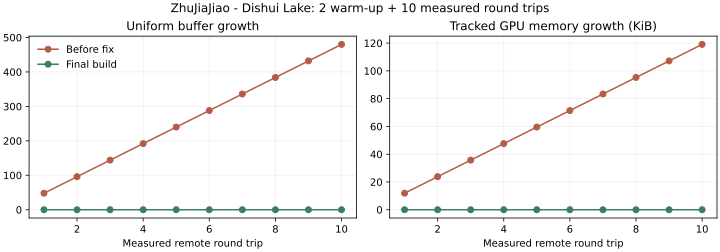
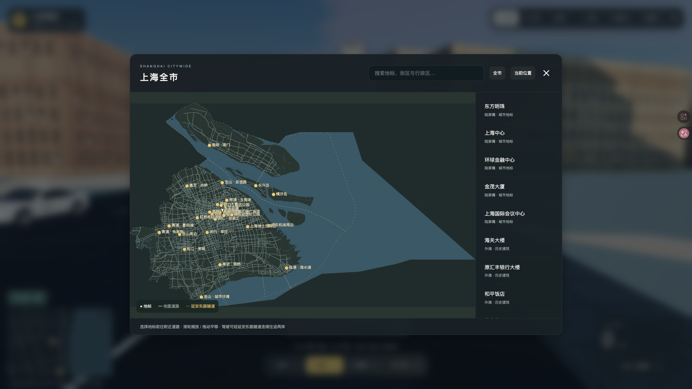

# 上海全市本地版 0.3.0 验收报告

本轮全市基础漫游的工程验收通过。覆盖上海市 16 区及主要岛屿，43 个目的地可搜索、跳转；保留 12 个专门制作地标和双向 10 米游戏洞宽的延安东路隧道。本轮只进行本地开发，没有发布或切换公网版本。

本地游玩：<http://127.0.0.1:4187/>。可编辑工程：`/Users/wuyanji/Desktop/上海漫游`。

## 范围与边界

全市数据包含源道路、水系、农田、建筑轮廓与确定种子的程序补楼，使用 1 km 城市块按需加载。崇明、长兴、横沙可搜索到达及飞行漫游。机场、迪士尼、佘山等新增目的地采用周边道路落点，没有完整专用模型或内部场景。

外围桥面净高、缺失楼高和地下高程采用标记过的视觉估算，地形平地化。其他 1477 个地下道路对象尚无洞体，未开放；长江隧道未制作。已完成专项连续驾驶验收的是延安东路双向洞线，全市其他桥隧没有逐条专项验收。

全市图的中心地名在最远缩放级别较密，可通过缩放和搜索分辨；外围建筑密度受源轮廓覆盖和稀疏补楼规则影响，仍有待细化的街区体量。美术认可保留给用户实机体验，不由工程通过结果代替。

## 数据来源与统计

全市 PBF 来自 OSM France / OpenStreetMap contributors，头部时间戳 `2026-10-23T02:06:05Z`，SHA256 `dd18c877fa0d4c798a3a0d84eccae53aa73238754f7e62a68f79ff9684258706`，提供方 MD5 已核对。市界关系 913067 与缺失五区边界另有固定原始响应及哈希。中心城区覆盖层沿用 2026-09-08 固定缓存。来源、许可和构建方法随源码交付，详见 [全市说明](../../CITYWIDE.md)。

| 项目 | 数量 |
|---|---:|
| 行政区 / 目的地 | 16 / 43 |
| 道路对象 | 188,784 |
| 源建筑体量 / 程序体量 / 保留中心区体量 | 117,574 / 455,961 / 23,652 |
| 1 km 逻辑城市块 | 30,418 |
| 含农田图层的块 | 1,485 |
| 分块有效载荷 / 启动 city.json | 329.44 MB / 7.73 MB |

建筑数量是渲染体量统计，不是官方唯一楼栋数。行政源几何约 16205.45 km²，包含管辖水域；扣除源水域后的几何陆域约 7148.98 km²，均不是官方面积统计。约 30168.03 km² 的渲染包围框包含灰色未建模背景，不作为开放陆域面积。

## 验证条件

Apple M2 Pro、16 GB；Tabbit **1.18.21.0** / Chromium **154.0.8037.58**，macOS，WebGPU，中档，实际渲染 **1920×1080**，renderer DPR=1。正式四模式采样均先预热 30 秒，再连续采样至少 301 秒。采样期间不构建、不录屏；随后录制隧道功能证明，隔离源码重建与功能检查并行。

最终 JS：`index-CkwP2jLv.js`，SHA256 `26a3163767ba92c1e23063e10a187a04928e211faec5850675b9957d66f42e5e`。城市主数据 SHA256：`995d3195e12dbdd2cc442559d2ef7df0827ec208d00376fed8c13a1fc6dba30a`。最终模式、六次驾驶、稳定性和资源往返均来自该构建。早期诊断保存在 `before-resource-fix/`，不计入最终通过结果。

## 功能与地理验证

- Node **45/45**、Python 地理与源完整性 **3/3** 通过；原始日志见 [unit-tests.log](unit-tests.log)、[geography-tests.log](geography-tests.log)、[隔离复现记录](source-reproduction.json)。
- 核心区 **32 个控制点**最大 ECEF-ENU 坐标转换偏差 **2.2873 米**，四个隧道端部接缝高差 0。精度核验仅针对固定核心区控制点，不能扩展为全市测绘精度。见 [地理检查](geography.json)、[叠合图](geography-overlay.svg)。
- **69 个固定源道路**核对方向、层级与节点；海岸夹具核对岛屿、江口和水域，没有用离岸道路推断填海。
- **43/43 目的地、129/129 次飞行转步行/汽车/自行车落点**通过，落点就绪且有效，最大目的地偏移约 155.67 米。见 [到达与落点](all-arrivals-and-landings.json)。
- 全部 43 名称与中文区名搜索、地图缩放/拖动/定位、真实键盘 1–4/W/V、搜索输入 `wasd1234` 隔离均通过。见 [地图检查](map-interactions.json)、[键盘检查](four-mode-controls.json)。
- 真正阻断目标 JSON 请求后保持原位置、解除后重试成功；迟到请求不能覆盖新目标；移动加载门禁通过。见 [加载异常](loading-scenarios.json)、[移动门禁](loading-gate.json)。
- 步行及骑行的隧道开口门禁通过；车辆可正常进入。见 [坡道专项](ramp-mode-gate.json)。

## 四模式性能

| 模式 | 实测路线 | 采样秒 | 移动公里（含预热） | P95 ms | 原始帧数 |
|---|---|---:|---:|---:|---:|
| 步行 | 朱家角 | 301.000 | 1.23 | **10.97** | 34622 |
| 汽车 | 闵行沪闵路 | 301.025 | 2.61 | **10.58** | 34589 |
| 自行车 | 宝山同济路 | 301.007 | 2.88 | **11.88** | 33508 |
| 直升机 | 滴水湖附近 | 301.023 | 7.15 | **9.29** | 35816 |

四项均满足 95% 帧耗时不超过 33.3 ms 的目标，完成移动、停止、镜头切换及昼夜变化。完整原始帧耗时及轨迹保存在 `modes/`。这是固定本机、路线、画质和视口的结果。

## 连续双向跨江

| 方向与时间 | 秒 | 最大横向偏差 m | 最小镜头顶板净距 m | 表面切换高差 m |
|---|---:|---:|---:|---:|
| east-golden-release | 171.76 | 0.909 | 2.661 | 0.000 |
| east-midday-release | 159.95 | 0.915 | 2.662 | 0.000 |
| east-midnight-release | 159.93 | 0.929 | 2.662 | 0.000 |
| west-golden-release | 161.13 | 1.410 | 2.642 | 0.000 |
| west-midday-release | 135.58 | 1.431 | 2.642 | 0.000 |
| west-midnight-release | 135.40 | 1.406 | 2.642 | 0.000 |

两个方向各连续三次，全程保持汽车模式，未传送或重载页面。轨迹 200 ms 采样的最大步进 3.861 米；最大横向偏差 1.431 米，镜头净距至少 2.642 米。黄昏两趟从真实地面连接道路驶入并驶出，四次表面接缝实测高差均为 0，满足 0.1 米目标。完整轨迹、模式及镜头记录在 `drives/`；完整录屏在 `recordings/`。

## 启动、稳定性与资源释放

本地清站点存储、绕过 HTTP 缓存，三次可操作时间 **2.155 / 1.739 / 1.601 秒**，中位数 **1.739 秒**。

50 Mbps、80 ms RTT 下三次为 **4.208 / 4.278 / 4.275 秒**，中位数 **4.275 秒**，满足 15 秒目标。浏览器/GPU 着色器缓存保留；不含下载安装包、解压和启动本地服务的时间。一次启动实测传输约 14.24 MB，整个城市包无需同时加载。分项导航、资源传输和编译时间见 [本地启动](local-startup.json)、[限速启动](cold-start.json)。

连续可见页面运行 **37.71 分钟**，453 次资源采样，应用错误、可见性中断均为 0，无黑屏或控制失效。朱家角与滴水湖之间预热 2 次、实测往返 10 次后，最后五轮 uniformBuffers=1134、geometries=635、textures=40、GPU 跟踪计数 **166.77 MB** 完全一致。JS heap 受 GC 影响波动，没有用它替代 GPU 释放检查。

本轮发现并修复普通 Mesh 只释放几何、未释放 WebGPU 对象绑定的问题：修复前每轮增加 48 个 uniform buffer；修复后预热基线的增量为 0。保留 [失败记录](lifecycle-before-resource-fix.json)、[最终资源记录](lifecycle.json)和 [修复说明](resource-fix.json)。

[37.71 分钟资源曲线](stability-resources.svg) · [原始稳定性数据](stability.json)

## 截图与录屏

**26 张**原生截图包含核心 6 固定机位 × 白天/黄昏/夜间共 18 张、6 个新区域视图、初始外滩和全市地图。捕获前等待实际渲染帧和当前路名更新，已覆盖早期落后一地点的快照。截图元数据与哈希见 [screenshots.json](screenshots.json)。检查了塔楼轮廓、窗格玻璃、外滩街景、昼夜水面和岛屿布局；外围采用简化体量的限制如上。

[外滩看陆家嘴](screenshots/V1-golden.png) · [同机位夜景](screenshots/V1-midnight.png) · [外滩街墙](screenshots/V5-midday.png) · [崇明](chongming.png) · [朱家角](zhujiajiao.png) · [滴水湖](dishui.png)

**7 段 H.264 录屏**已逐段完整解码通过：6 段完整过江及 1 段四模式移动、停止、镜头和昼夜操作。录屏以原生 CDP 页面捕获，帧时间戳保留；录屏不参与四模式性能判定。见 [编码与解码校验](recordings/encoded-audit.json)。

## 静态包与源码复现

静态包 **101.26 MB**，完整可编辑源码包 **107.52 MB**。静态包内 **8576 文件哈希一致、8541 必需资源 HTTP 全部成功**；独立目录在 4193 端口实际启动并到达崇明，应用错误为 0。浏览器实际请求记录没有外部 HTTP 资源依赖，所有运行数据来自本地，见 [静态检查](release-audit.json)、[独立包浏览器](standalone-browser.json)、[网络记录](network.json)。

源码包解压到隔离目录，npm ci、Node/Python 测试、PBF 导入、全市数据再生成和网页构建全部通过，**8541 产物逐文件哈希一致**，总计 667.81 秒。Python 依赖使用工程已有的锁定 `.venv`，源码和 npm 安装独立；不宣称在另一台空白机器安装过 Python 依赖。复现目录已自动删除。最终验收证据在工程中另行交付，不包含在源码压缩包内。

| 文件 | SHA256 |
|---|---|
| shanghai-waterfront-0.3.0.tar.gz | `dd2006f7f888b4c591ab188aa73b1e325acc9b25534b20b2cc039393545773ff` |
| shanghai-waterfront-0.3.0-source.tar.gz | `8573e6fec029819f5476b93b233b1d0fcfa3ca8429af0721815a37612297021a` |

旧 0.2.0 两个归档的哈希与原交付清单一致，保持原样。当前本地预览保留 4187，4193 仅作验收后关闭。部署与启动方法见 [部署说明](../../deployment.md)，完整交付索引见 `release/DELIVERY.json`。

浏览器任务的历史汇总另保留早期预览未启动时的连接拒绝、早期试验期间的 ReferenceError 及两次主动阻断请求记录，见 [任务诊断](browser-task-diagnostics.json)。最终构建的37.71分钟运行与最终页面错误列表均为空；这些历史记录不计为最终构建运行错误。
