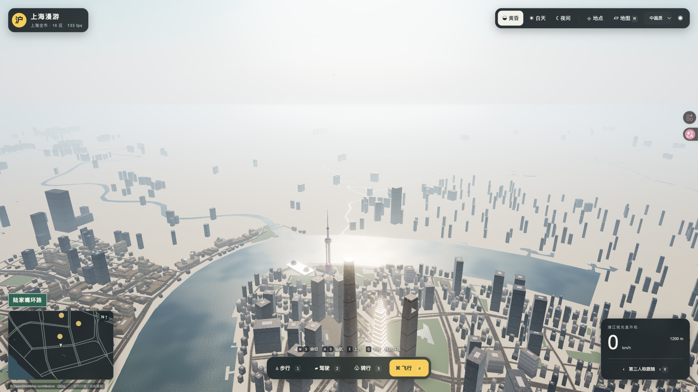
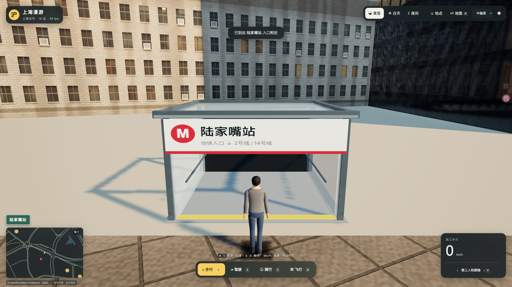
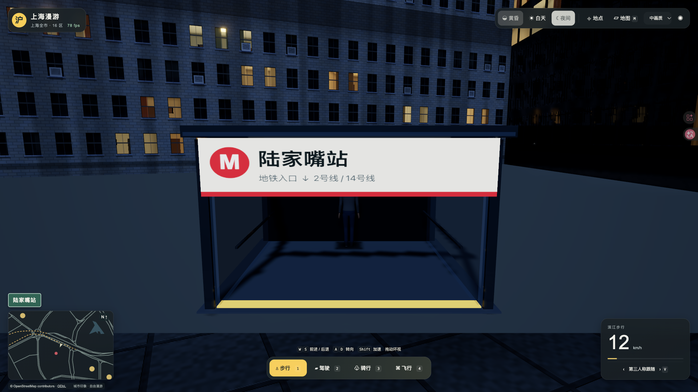
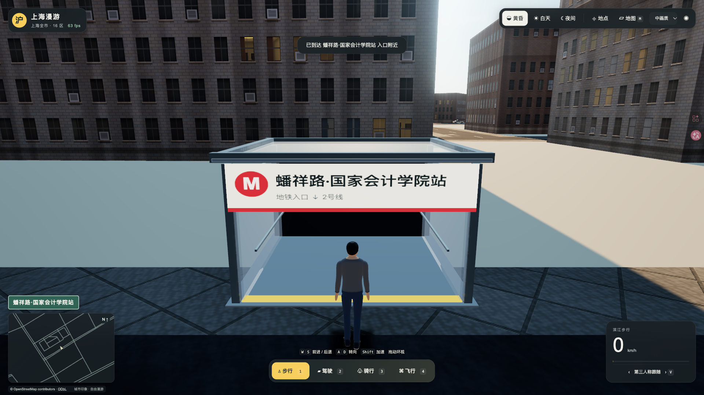
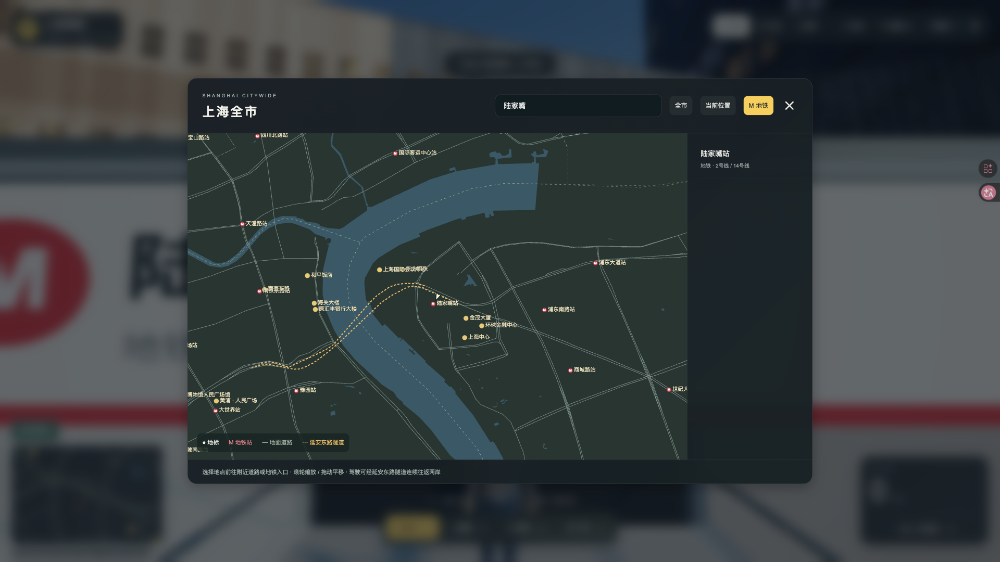

# 0.3.1 高空飞行与地铁入口验收

本轮两项优化已完成并通过本地验证。直升机上限由380m提高为1200m；上海境内410个独立地铁站名均有M标志、站名牌及可走入的简化门厅，支持地图搜索与跳转。本次未发布线上，0.3.0归档保留。

## 使用与范围

本地地址：<http://127.0.0.1:4187/>。按4切换飞行、E上升、Q下降；地图搜索站名，或通过“地点 → M 地铁站查询”选择车站。M地铁按钮控制图层。每站制作一个代表入口，步行和骑行跳转到入口地面，汽车使用附近道路，高空跳转保留飞行高度。

[上海地铁官方逐线参考](https://service.shmetro.com/)的1–18号线及浦江线共有413个独立站名，全部匹配固定OSM PBF；剔除位于昆山的花桥、光明路、兆丰路后为410站。313个入口使用真实OSM出入口坐标，97个在附近可通行人行空间估算，最大距选定站域中心245.77m。官方GIS坐标没有用于场景，站域和入口分别保留WGS84来源。市域机场线、未开通施工站、机场旅客捷运不在本次清单；未制作站台、列车或地铁地下漫游。见[范围和重建说明](../../FLIGHT-METRO.md)、[数据统计](../../metro-audit.json)。

## 验证结果

设备为Apple M2 Pro、16GB内存，Tabbit Chromium 154.0.8037.58，WebGPU、中画质、1920×1080、renderer DPR=1。完整环境见[environment.json](environment.json)。

| 项目 | 实测结果 | 证据 |
| --- | --- | --- |
| 单元测试 | Node 51/51、Python 7/7；新增高度、换乘排重、别名、未开通过滤、几何修复、入口碰撞及高架落点回归 | [Node](unit-tests.log)、[Python](python-tests.log) |
| 飞越上海中心 | 实际升至854.71m，在上海中心平面中心0.115m内经过，高于632m模型；到地铁与地标均保持854.71m | [飞行轨迹与原始帧](high-flight.json) |
| 触顶与下降 | 触顶1200m向上速度为0；按Q后1.615s降到1180m以下 | [检查结果](flight-status.json) |
| 逐站落点 | 410/410入口加载、站名标牌存在、非水面；所有步行落点高度2.12m，距入口中心最大误差小于0.000001m | [逐站结果](station-arrivals.json) |
| 搜索与地图 | 410个站名逐一检索，浦江线6站；图层开关和输入文字不驱动角色均通过；选中按钮对比度已修正 | [地图检查](map.json)、[最终按钮检查](map-contrast.json) |
| 实际走进入口 | 陆家嘴、上海南站、蟠祥路·国家会计学院均由入口外走至后墙，localZ=-1.53m，地面2.12m，无遮挡穿行；后墙正常阻挡 | [步行轨迹](metro-walk-final.json) |
| 高空性能 | 30s预热，采样301.004s，22,266帧，P95 **22.21ms** | [原始记录](high-flight.json) |
| 密集街区性能 | 30s预热，采样301.036s，19,521帧，行进1233.97m，P95 **25.05ms** | [原始记录](dense-metro-performance.json) |
| 四种模式 | 步行、驾驶、骑行、飞行的移动、停止、三种镜头与飞行后落地通过 | [操作检查](mode-smoke.json) |
| 冷启动 | 清理站点存储、绕过HTTP缓存，50Mbps/80ms；三次8.28/6.92/4.86s，首次可操作中位数 **6.92s** | [原始记录](cold-start.json) |
| 资源释放 | 人民广场—滴水湖2次预热后10次往返；最后5次几何364、纹理35、UBO522、程序87及总资源165,408,444字节完全一致 | [资源记录](lifecycle.json) |
| 地下回归 | 追加一次东行夜间地面—隧道—地面连续驾驶，172.83s；最大偏线0.940m、路面接缝采样高差0m、相机顶板净距至少2.656m，无应用错误 | [驾驶轨迹](drives/metro-east-regression.json) |
| 独立包 | 8,604个文件校验、8,542个必需资源HTTP检查通过；独立4194服务可启动并搜索进入陆家嘴站 | [包核验](release-audit.json)、[独立浏览器检查](standalone-browser.json) |
| 离线资源 | 浏览器记录未发现外部HTTP请求、资源失败或运行错误 | [网络记录](network-audit.json) |
| 源码复现 | 固定数据完整重建通过；最终包在干净目录npm ci/build后8,542个输出逐一匹配 | [完整地理重建](source-reproduction-geography.json)、[最终源码验证](source-reproduction.json) |

飞行采样包含爬升、越过上海中心、两次地点跳转、触顶/下降及高空巡航；地下连续驾驶单独检验。采样资产名为`index-DSISJdA1.js`，最后仅修正地图按钮CSS，交付名变为`index-CpMz8H2Y.js`，两者JavaScript SHA256均为`308142dba88fda4f357b82d330a0ebf29359a7fbe123c9ca587d2998f7b31aa2`，文件内容完全相同。最终源码包另有17,607个文件与完整重建过的快照逐字节一致，唯一变化为style.css，见[source-transition.json](source-transition.json)。没有为此重复全市地理重建；最终源码包已单独干净构建并比对全部输出。

## 画面

[全市地铁地图](metro-full-map.png)、[上海南站入口](metro-0115-entrance.png)一并保留。工程验证不等同于用户对新增外观的审美确认。

## 修复与验证边界

首轮逐站检查中，5处落点受旁边高架影响，上海西站被吸附到远处普通道路。新增失败测试并加入独立门厅地面后，全410站复验通过。选址所用街区多边形有舍入自交，采用make_valid修复用于选址，未改动原全市地理数据。

期间有浏览器任务租约重建、视口恢复及测试夹具首帧初始化错误；诊断保留在viewport-diagnostic.json、walk-fixture-diagnostic.json和执行记录中。修正夹具、重新加载后完成正式验证，未把这些诊断采样当作通过结果。

本轮按两项改动做针对性验证，包含两段5分钟性能采样、逐站检查、10次资源往返和追加隧道驾驶。0.3.0的四模式完整路线、六次跨江、37.71分钟稳定性记录保留在[历史报告](../0.3.0/REPORT.md)，没有宣称本轮重新执行这些历史检查。外围建筑与地形等既有视觉估算范围延续。

## 交付

| 文件 | 字节 | SHA256 |
| --- | ---: | --- |
| `shanghai-waterfront-0.3.1.tar.gz` | 101,440,238 | `3ec290eee50885c11ae8cde3ee3c4bb0860c9cae9cc6031217c0c5105e3eb196` |
| `shanghai-waterfront-0.3.1-source.tar.gz` | 107,705,996 | `f8d8d28e2e27ef0c48f63f6233717ea7d3fe8dadc16dfb34021e3ee4a1f1cea1` |

[静态运行包](../../../release/shanghai-waterfront-0.3.1.tar.gz)、[完整源码包](../../../release/shanghai-waterfront-0.3.1-source.tar.gz)。解压静态包后执行`node serve.mjs --port 4187`，需要Node.js 22.12+；页面通过HTTP启动，游玩不查询公共地图API。固定原始数据、许可和生成器已随包保留，截图、报告、原始日志在工程目录单独交付。

机器摘要见[summary.json](summary.json)，代码自查见[code-review.md](code-review.md)。本地4187预览保留，4194临时服务及测试临时页已清理。
