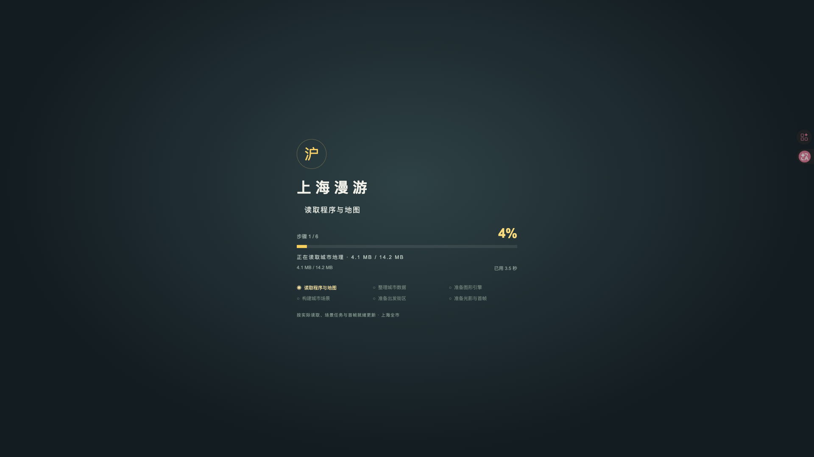
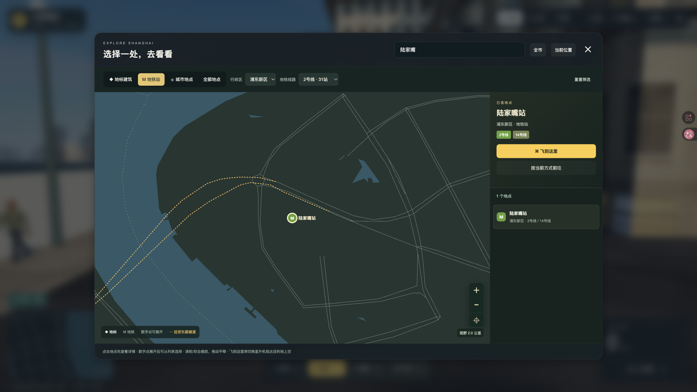
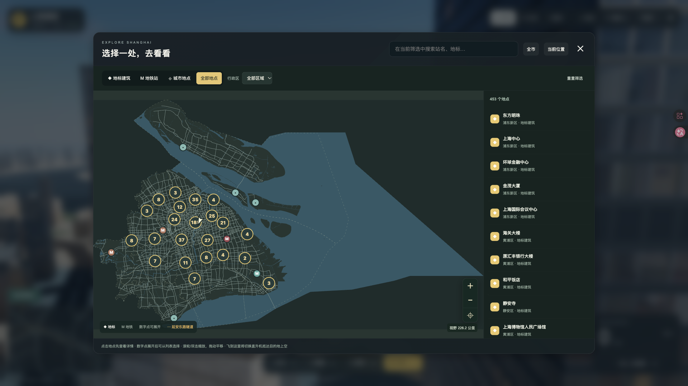

# 上海漫游 0.3.2 验收报告

2026-10-24发布前本地验收：真实启动进度、地图筛选、缩放及显式飞行功能通过，0.3.1归档已保留并核对校验值。刷新 http://127.0.0.1:4187/ 可使用本地版本。随后已按用户授权于当日22:03发布到原独立域名，见[公网发布报告](../../deployment/2026-10-24-0.3.2/REPORT.md)；下文仍保留本地验收当时的证据与范围。

## 交付行为

- 启动按读取资源、解析数据、准备引擎、构建场景、挂载出发街区、光影与首帧6步展示实际完成量。显示已读取字节、任务计数和等待时间；首帧及GPU队列完成后才到100%。失败显示具体资源并可重试。百分比是任务完成度，不表示剩余时间，也不随计时器自动增长。
- 地图默认仅显示12个地标，可切换410个地铁站、31个城市地点或全部453个地点。支持现有1–18号线及浦江线共19条线路、16个行政区与名称组合筛选，换乘站保留各自线路归属。
- 密集标记聚合为数字点；展开后可从成员列表精确选择。支持按钮、滚轮、双击缩放与拖动，具备全市、当前位置和适配结果。筛选结果先保留至少2公里上下文，手动可放大到250米视野。
- 选中地点先展示详情；点击“飞到这里”才在目标街区就绪后切换直升机并抵达附近空中。“按当前方式前往”保留交通方式。失败或过期请求不改变原位置；等待期间驶入隧道也会在提交前再次阻止切换。

使用说明见 [LOADING-MAP.md](../../LOADING-MAP.md)。

## 验证结果

| 项目 | 结果与证据 |
| --- | --- |
| 自动化与构建 | 源码包解压、独立npm ci后，64项Node与7项Python测试全部通过；重新构建的8,545个静态文件逐一一致。[复现记录](source-reproduction.json)、[完整日志](source-reproduction.log) |
| 真实加载 | 10 Mbps／80 ms限速、实际字节变化、阶段计数、进度不倒退且不提前100%；阻断metro.json显示失败，解除后点击重试成功。[限速轨迹](slow-startup.json)、[失败状态](loading-failure.json)、[重试结果](loading-retry-result.json) |
| 地图与飞行 | 19条线路逐一与站点源集合核对；类型/行政区/搜索组合、换乘标签、聚合成员、缩放/拖动、空结果恢复、输入隔离、选点不移动、显式飞行及普通前往均通过。[地图交互](map-interactions.json) |
| 加载与导航边界 | 目标就绪前保留原状态；新目标覆盖旧目标，迟到/失败请求不改变已抵达位置。[竞态检查](navigation-lifecycle.json) |
| 隧道限制 | 车辆实际驶入隧道后才释放等待中的请求，飞行导航和普通模式切换都被阻止，汽车模式与位置保留，无应用错误。[专项回归](tunnel-commit-regression.json) |
| 四种模式 | 步行、汽车、自行车、直升机均完成移动、停止和3种相机检查，飞行后落地有效。[模式回归](mode-smoke.json) |
| 冷启动 | 50 Mbps／80 ms、清理站点存储并绕过HTTP缓存，3次为6.807／6.548／6.499秒，中位6.548秒。[原始记录](cold-start.json) |
| 性能 | 预热30秒后采样301.003秒、32,974帧，P95为11.73 ms；最终构建追加30.007秒、2,144帧，P95为15.905 ms，应用错误为空。[5分钟采样](ground-performance.json)、[最终构建采样](final-view-smoke.json) |
| 资源生命周期 | 预热2轮后人民广场—滴水湖往返10轮，最后5轮GPU资源计数一致：550个geometry、40个texture、1,062个uniform buffer，总计168,175,490字节。[原始记录](lifecycle.json) |
| 独立运行包 | 全部8,608个清单文件校验通过；8,545个必要网页资源HTTP读取一致。独立4194服务启动、筛选浦江线并飞到沈杜公路站成功，无应用错误或外部请求。[资源检查](release-audit.json)、[独立包实机](standalone-browser.json) |

参考环境为Apple M2 Pro、16 GiB、Tabbit Chromium 154.0.8037.58、WebGPU、中档画质，实际渲染1920×1080、DPR=1，采样时页面可见。[环境记录](environment.json)

5分钟采样、冷启动、四模式与生命周期记录来自本轮`app-BnWJjc5z.js`。随后仅调整`map.js`和`map-view.js`的筛选结果视野下限，渲染、控制、场景和加载源码未变；最终`app-CDigLgQs.js`重新通过完整地图交互、30秒采样、源码复现及独立包实机验证。[变更范围](final-view-change.json)

本轮是上述功能的针对性回归，未重跑历史全市完整验收或30分钟长稳测试；GPU资源计数稳定不等同于已经证明所有JavaScript堆对象均无泄漏。

## 画面与交付

- [可运行静态包](../../../release/shanghai-waterfront-0.3.2.tar.gz)：解压后执行`node serve.mjs --port 4187`。
- [完整源码包](../../../release/shanghai-waterfront-0.3.2-source.tar.gz)：固定npm依赖、地理数据和构建说明齐全；验收媒体在本报告目录另行交付。
- [交付清单](../../../release/DELIVERY-0.3.2.json)、[文件校验值](artifact-hashes.json)、[结构化结果](summary.json)。

地理、站点与生成器的8,586份内容文件和0.3.1完全一致。本次未重新生成地理；地铁仍沿用既有站点数据范围，未新增线路或入口。[地理保留核对](geography-preserved.json)

独立审查发现的异步等待后隧道状态未复核问题已补测试并修复。测试夹具的租约恢复/证据写入故障不作为通过结果，正式记录使用修复后的成功运行。[审查记录](code-review.md)

临时4194服务与源码复现目录已清理，浏览器限速/缓存/视口覆盖已恢复，保留4187预览及一个结果页面。[清理记录](cleanup.json)
