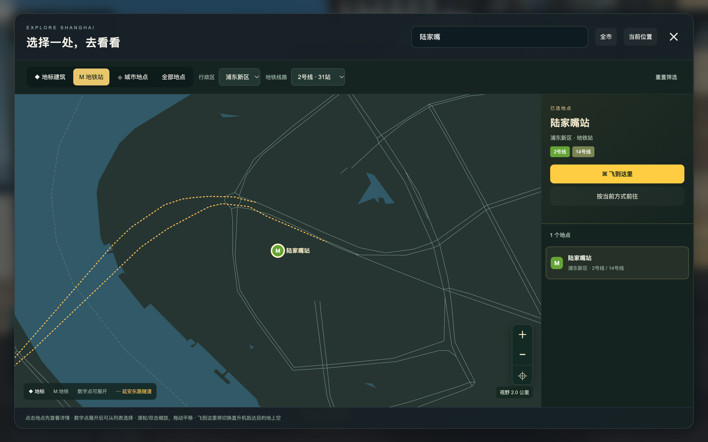
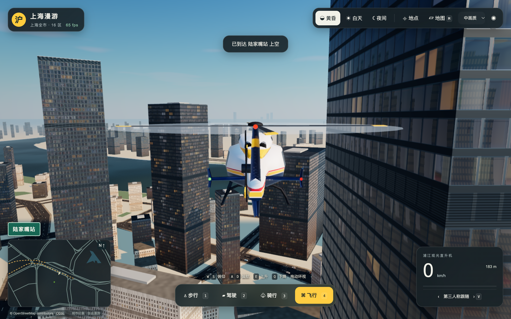

# 上海漫游 0.3.2 阿里云发布记录

2026-10-24 22:03（Asia/Shanghai）发布成功，沿用已有独立域名：

- 正式入口：[shanghai.datiaomao.com](https://shanghai.datiaomao.com/)。
- 市场入口：[apps.datiaomao.com/apps/shanghai-roam/](https://apps.datiaomao.com/apps/shanghai-roam/)。
- 固定应用ID：`shanghai-roam`；发布快照：`20261024-220216-6a4aab`。
- 应用构建：`app-CDigLgQs.js`，SHA-256为`72cfe2aee5f636a5c72e56b1a2817ec842ee47e1b92f77a8531f8effc8071970`。

两入口共用同一不可变产物目录`/var/www/app-market/app-releases/shanghai-roam/20261024-220216-6a4aab`。本次未创建域名或申请证书，更新沿用原应用ID。运行代码与此前本地验收的0.3.2一致；仅调整发布说明及健康检查配置。

## 发布与公网验证

| 检查 | 结果与证据 |
| --- | --- |
| 发布前盘点 | 原线上应用为0.2.0，快照`20261024-101402-46d277`。[发布前状态](inventory-before.json) |
| 构建预演 | 8,545个原始运行文件逐一与已验收dist校验一致；含gzip副本共15,823个文件、414,145,702字节。实际发布清单与预演完全一致。[预演核对](preflight.json)、[文件清单](payload-SHA256.json) |
| 服务器切换 | 发布器完成上传校验、Nginx配置检查、原子切换和健康探测，状态为published。[事务结果](publish.json)、[完整发布记录](release-record.json) |
| 两入口资源 | 18次关键文件读取与本地内容完全一致，其中16个响应采用gzip，按解码后内容核对；两入口缺失资源均返回404。启动清单使用重新验证缓存。[HTTP检查](http-checks.json) |
| 共享站点探针 | 46项通过，无失败。[公网探针](market-public-checks.json) |
| 实际启动 | 独立Google Chrome 155.0.8059.85、WebGPU、安全上下文、实际渲染1440×900。6步全部完成，实际读取14,167,330字节；进度不倒退且100%时已就绪。[浏览器记录](isolated-browser.json) |
| 地图筛选 | 默认12地标；410站、19条线路、16区；2号线31站，叠加浦东新区和陆家嘴得到唯一结果，换乘标签2/14号线正确，选中时未移动。缩放按钮生效，全市21个聚合点保留全部410个站点。[浏览器记录](isolated-browser.json) |
| 飞行与操作 | 原生点击“飞到这里”，切换直升机并抵达陆家嘴站上空180米；距站点代表入口7.65米，目标街区就绪。点击画布后按物理KeyE升至183.09米；夜间和相机按钮检查通过。应用错误、页面错误及失败请求均为空。[浏览器记录](isolated-browser.json) |
| 市场子路径 | 实际打开市场入口完成启动，默认12地标，浦江线筛选为6站，相对资源路径正确。[浏览器记录](isolated-browser.json) |
| 其他应用与服务 | 其他5个应用版本、5份旧站点配置摘要及4个容器状态保持一致。[前后核对](unrelated-preserved.json)、[发布后盘点](inventory-after.json) |

本轮复用此前0.3.2的64项Node、7项Python及源码复现验收，未修改运行代码或重复运行这71项测试。原验收见[本地报告](../../acceptance/0.3.2/REPORT.md)。本次公网启动记录是功能验证中的单次观测，不替代固定限速条件下的三次冷启动或性能验收。

## 画面

## 验证限制与排查记录

本轮既有Tabbit会话出现图形设备初始化等待：独立调用navigator.gpu.requestAdapter在5秒检查窗内未完成，不加载游戏代码的本地JSON页面也可重现。其默认启动未在检查窗内就绪，WebGL诊断路径也停在材质准备；没有将这些尝试算作通过。未改浏览器全局图形设置或重启用户浏览器，最终交互验收使用独立Chrome的WebGPU路径。本轮不宣称已重新完成Tabbit兼容验收。[最初状态](startup-diagnostic.json)、[独立API探针](isolated-gpu-probe.json)、[Tabbit收尾状态](tabbit-cleanup.json)

独立Chrome首次按键夹具超时，随后明确点击画布并发送物理KeyE，完整流程通过；未为此修改应用代码。首轮诊断保留在[首次浏览器记录](isolated-browser-before-focus.json)，成功流程与脚本分别在[最终记录](isolated-browser.json)、[复现脚本](isolated-browser-check.cjs)。

## 回滚与清理

上一成功应用版本`20261024-101402-46d277`（0.2.0）继续保留。通过统一发布器对`shanghai-roam`执行单应用回滚，先dry-run再正式执行；不要手动移动旧current链接。统一发布器在`/Users/wuyanji/Desktop/编程/app-market/scripts/market.py`，记录位于该项目deployment/records/。

本次两份本机构建暂存及服务器incoming事务内的assets已清理；成功快照、当前应用和旧版回滚目录保留。本地0.3.2源码包与运行包哈希未变。独立Chrome测试进程已关闭，Tabbit两个本次测试页已关闭、缓存覆盖恢复，原本地预览页保留。[清理记录](cleanup.json)

## 附：GitHub Desktop 本地路径

用户截图中的旧目录`/Users/wuyanji/Desktop/上海漫游/ShangHai`已不存在，当前真实Git根目录为`/Users/wuyanji/Desktop/上海漫游`，远程配置为`https://github.com/YakirLove/ShangHai.git`。已通过GitHub Desktop的Locate关联当前根目录，恢复显示main与未提交改动。没有移动项目文件、创建新仓库或提交推送。[定位记录](repository-path-diagnostic.json)
