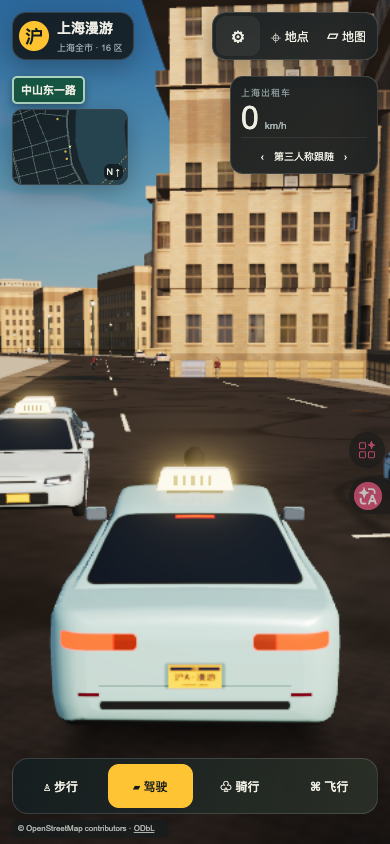
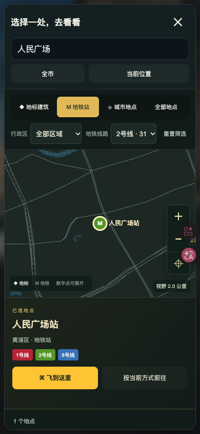

# 上海漫游 0.3.3 阿里云发布记录

2026-11-09发布成功，沿用已有固定ID `shanghai-roam`。

- 正式入口：[shanghai.datiaomao.com](https://shanghai.datiaomao.com/)。
- 市场入口：[apps.datiaomao.com/apps/shanghai-roam/](https://apps.datiaomao.com/apps/shanghai-roam/)。
- 发布快照：`20261109-175451-d7b8d3`；服务器发布时间：`2026-11-09T17:56:56+08:00`。
- 两入口共用 `/var/www/app-market/app-releases/shanghai-roam/20261109-175451-d7b8d3`。
- 上一成功版本：`20261024-220216-6a4aab`（0.3.2），继续保留用于单应用回滚。
- 运行改动：[808acab](https://github.com/YakirLove/ShangHai/commit/808acab21fb7af0304b22c65437d6fcdf8564f3c)。主程序 `assets/app-CBTdWHrC.js`，SHA-256 `9d4e93e5a9c779dbe10a91a03ca10f2215e5234204041e2280007a9e5ab35a14`。

本轮修复手机端小地图、速度面板与模式切换的遮挡；将场景设置改为折叠菜单；地图在小屏改为可滚动单栏并保留搜索和关闭入口；增加隐藏界面后的恢复按钮。适配安全区与动态视口，触屏打开地图时不自动唤起搜索键盘。玩法、城市数据和地铁站点范围沿用0.3.2。

| 核查 | 结果与证据 |
| --- | --- |
| 发布前盘点 | 确认原线上0.3.2及现有6个应用。[发布前状态](inventory-before.json) |
| 预演和产物 | 8,545个原始运行文件与已验收dist逐一一致；含gzip共15,823个文件、414,157,320字节。正式发布清单与预演完全一致。[预演](dry-run.json)、[预检](preflight.json)、[HTTP核对](http-checks.json) |
| 服务器切换 | 上传校验、Nginx检查和原子切换成功，状态为published。[发布结果](publish.json)、[完整记录](release-record.json) |
| 两入口资源 | 18次入口、程序、样式和地图数据读取的解码后SHA-256全部匹配；两个缺失文件检查均返回404。市场中应用ID唯一。[20项HTTP检查](http-checks.json) |
| 共享站点 | 46项探针通过，无失败。[公网探针](market-public-checks.json) |
| 实际启动 | Tabbit Chromium，HTTPS安全上下文、WebGPU，启动完成且无应用或页面错误。启动耗时为一次公网观测，不作为性能基准。[启动记录](public-startup.json) |
| 手机与桌面布局 | 公网320×568、360×640、390×844、430×932、768×1024、568×320、844×390、1024×768、1440×900共9组尺寸通过。面板无重叠和越界；设置、隐藏与恢复、地点菜单、地图搜索、线路筛选及目的地按钮可操作。[布局检查](public-layout-checks.json)、[复现脚本](../../../tests/browser/mobile-layout.js) |
| 地图与飞行 | 真实点击搜索人民广场站并飞到180米上空；市场子路径完成独立启动，410站数据和2号线31站筛选正常。应用及页面错误为空。[交互记录](public-interactions.json) |
| 其他应用与服务 | 其他5个应用元数据、6份站点配置摘要和5个运行容器的名字与镜像保持一致。[前后核对](unrelated-preserved.json)、[发布后状态](inventory-after.json) |
| 清理与回滚 | 清理本次两份专用本机构建及incoming资产；保留当前版本、上一0.3.2版本和发布记录。[清理记录](cleanup.json) |

发布前已通过64项Node测试、9组本地尺寸检查和生产构建，见[本地验收](../../acceptance/mobile-layout-2026-11-09/checks.json)。部署阶段重新构建并逐文件比对运行产物，在公网验证交互。布局验证使用Chromium视口和触摸模拟，尚未进行iOS/Android真机或Safari验收。

回滚使用统一发布器的 `rollback --app shanghai-roam --version 20261024-220216-6a4aab`，先加 `--dry-run` 预演，再正式执行。沿用原域名和证书，发布流程见[部署说明](../../deployment.md)。
