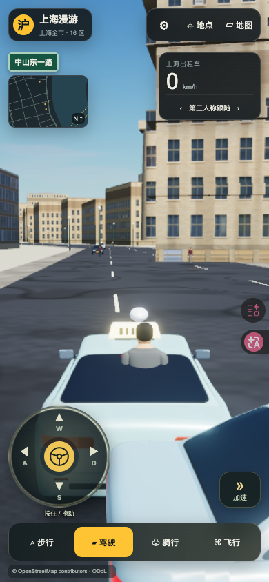
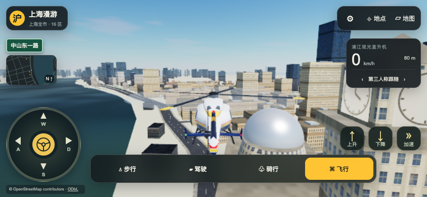

# 上海漫游 0.3.4 · 手机触屏控制发布记录

2026-11-10发布成功。正式入口：[上海漫游](https://shanghai.datiaomao.com/)，市场入口：[上海漫游市场页面](https://apps.datiaomao.com/apps/shanghai-roam/)。

- 固定应用ID：`shanghai-roam`；发布快照：`20261110-091445-268583`。
- 服务器发布时间：`2026-11-10T09:16:33+08:00`。
- 两入口共用 `/var/www/app-market/app-releases/shanghai-roam/20261110-091445-268583`。
- 上一成功版本：`20261109-175451-d7b8d3`（0.3.3），保留用于回滚。
- 运行代码：[641deaa](https://github.com/YakirLove/ShangHai/commit/641deaaf46f4a0477f424388bb6eef3a21ff8fdc)。

0.3.3只调整了手机布局，缺少触屏移动入口。0.3.4在左下加入方向盘：W/S前进后退、A/D转向，斜向拖动可同时前进与转弯。右侧提供加速、步行跳跃和飞行升降。输入按手指分别持有，松开加速不影响方向盘；松手、取消触摸、窗口失焦、切换模式、打开地图和旋转屏幕均清除对应触屏输入。

触屏方向盘复用现有控制器输入层，保留键盘和手柄的独立输入。触屏设备或小窗口显示控制面板；低高度横屏隐藏小地图和额外说明，给方向盘、升降和模式按钮留出空间。

| 验证 | 结果与证据 |
| --- | --- |
| 本地测试 | 70项Node测试通过，包含6项触屏状态与方向映射检查；生产构建通过。[本地检查](../../acceptance/touch-controls-2026-11-10/checks.json) |
| 实际触摸位移 | 本地与公网使用浏览器触摸协议，驾驶、步行和骑行均实际移动超过0.8米；飞行上升和下降均改变高度。[本地位移](../../acceptance/touch-controls-2026-11-10/movement.json)、[公网位移](public-movement.json) |
| 多指与释放 | 斜向拖动、加速叠加、单独抬起加速、拖动换为后退、touchcancel、打开/关闭地图、切模式、失焦及屏幕旋转检查通过。关闭地图后旧手指不会恢复移动。[公网检查](public-movement.json)、[复现脚本](../../../tests/browser/touch-movement.js) |
| 横竖屏 | 320×568、360×640、390×844、430×932、768×1024、568×320、844×390、932×430、1024×768、1440×900共10组检查通过；方向盘、动作按钮、模式切换及署名无重叠越界。[公网布局](public-layout.json)、[复现脚本](../../../tests/browser/mobile-layout.js) |
| 市场子路径 | 市场入口独立启动并实际触摸前进，位移和松手释放均通过，应用错误为空。[市场验证](market-touch.json) |
| 发布与资源 | 8,545个原始运行文件与本地验收dist逐一一致；含gzip共15,823个文件、414,167,274字节。正式发布清单与预演一致。两入口18次资源SHA-256及两个404检查通过。[预检](preflight.json)、[HTTP检查](http-checks.json)、[发布记录](release-record.json) |
| 公网及其他应用 | 46项站点探针通过；其他5个应用元数据、6份站点配置摘要和5个运行容器的名字/镜像保持一致。[探针](market-public-checks.json)、[前后核对](unrelated-preserved.json) |
| 清理 | 本次专用构建目录和incoming资产已清理，当前版本、上版与发布记录保留。[清理记录](cleanup.json) |

本轮验证基于Tabbit Chromium视口与触摸模拟，未进行iOS/Android真机或Safari验收。启动记录见[startup.json](startup.json)，前后服务器状态见[inventory-before.json](inventory-before.json)、[inventory-after.json](inventory-after.json)。

回滚使用统一发布器的 `rollback --app shanghai-roam --version 20261109-175451-d7b8d3`，先加 `--dry-run` 预演，再正式执行。域名、证书及后台服务沿用原部署。
