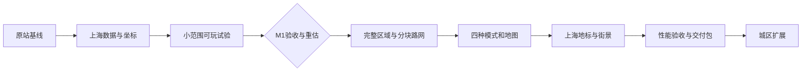

> 本文是早期扩展路线草案。当前用户已确认首版必须经延安东路隧道连续双向驾车过江，优先于本文历史条款。正式执行范围见本聊天中用户批准的“外滩—陆家嘴首版交付计划与验收标准”，进展见 docs/implementation-progress.md。

# 上海城市漫游实施计划

> 执行说明：本轮只制定计划。后续开发按 `superpowers:executing-plans` 逐项推进，由当前 Agent 连续完成；不预设子 Agent 分工。任务用复选框跟踪，阶段验收结论必须附实际产物和证据。

**Goal：** 做出与 Slop New York 同等画风和核心玩法、上海道路、水系及地标可辨认的网页漫游；先交付外滩—陆家嘴，再按城区扩展。

**Architecture：** 复用原站的渲染、材质、角色控制和相机，抽离纽约地理依赖。离线加工真实道路、水面和建筑轮廓，生成带版本的静态城市块；普通楼宇按上海街区规则生成，地标使用独立模型覆盖。

**Tech Stack：** 原生 JavaScript ES Modules、Three.js WebGPURenderer / TSL、Node.js 离线数据工具及 `node:test`；计划增加 Vite 用于本地开发与静态打包，保持原有页面与运行模块结构。Three.js 核心和 addons 固定到同一已验证 revision，其他构建依赖写入 lockfile。

**Spec：** [可行性评估](/Users/wuyanji/Desktop/编程/上海城市漫游/可行性评估.md)、[上海地图数据核验](/Users/wuyanji/Desktop/编程/上海城市漫游/调研/上海地图数据核验.md)。

编制日期：2026-10-23，Asia/Shanghai。实施根目录拟定为 `/Users/wuyanji/Desktop/上海漫游`。编制时该目录为空，尚无本地应用源码；下文代码路径均为未来引入或新增的文件，不代表已经实现。

## 1. 交付范围与约束

### 已确认目标

- 原站同等画风和玩法，上海道路、水系、地标可辨认。
- 真实地理布局优先；普通建筑允许估算高度和类型化立面，不要求逐栋实景复原。
- 核心玩法包括步行、驾驶、骑行、直升机，配套相机、小地图、全屏地图、地点跳转和昼夜变化。
- 单人网页应用采用静态资源部署，首版无需账号和业务后端。

### 本计划采用的建议基线

这些是为落实排期而提出的范围决策，不应写成用户已经逐项确认。

| 项目 | 计划基线 |
|---|---|
| 技术试验 | 约 1–2 km²，陆家嘴滨江与东方明珠周边；完整江面的一段、真实道路、基础楼群、1 个简化地标 |
| 首个可玩区 | 沿用已调查 bbox `[121.48, 31.22, 121.52, 31.25]`，约 12.7 km²；边界以完整数据和道路连接检查后的小幅调整为准 |
| 核心内容 | 黄浦江两岸、苏州河口、滨江步道、主要地面道路，8 个重点地标及普通楼群 |
| 首发环境 | 常规桌面浏览器、键鼠操作，先以 Tabbit 的 Chromium / WebGPU 路径验收；记录具体设备及版本 |
| 跨江方式 | 首版采用直升机和地点跳转；地面道路按各岸真实路网连接，完整桥隧驾驶放入扩展阶段 |
| 手机端 | 保留原站触控能力，桌面首版后单独做触控、画质和实机验收，不混入桌面工期承诺 |
| 全上海 | 作为分区扩展方向，核心区精细、外围简化；全市范围与质量分级在数据审计后确定 |

首版不安排建筑内部、地铁运营、任务经济系统、多人联机或全市逐栋写实建模。现有车流、行人及街景氛围属于同等体验的一部分，需要迁移到上海道路。

### Global Constraints

- 上游源码基线固定为 `mrdoob/slop-newyork@1f665309d69ec53b5337a4b8625e1abff48a30bb`，不随上游 dev 分支漂移。
- 数据输入统一为 WGS84；运行坐标为米，`x` 向东、`y` 向上、`z` 向南，不继续使用曼哈顿旋转角。
- 建议局部原点为 `[121.495, 31.237]`，所有道路、水面、地标、地图和碰撞使用同一转换函数。全市扩展时再验证局部原点与浮点精度策略。
- 地图样本的 3,168 是带标签的对象数，不能作为唯一楼栋数量或完整轮廓验收值；757 个有高度或楼层标签也不代表高度已核实。
- 江面来自完整水体多边形及关系成员；河流中心线不能作为真实岸线替代品。
- 道路在二维图上相交不等于互通；保留方向、通行类型、桥、隧道和层级。`layer` 不能直接当成真实海拔。
- 高度与样式生成使用稳定种子，并记录来源；地标覆盖相应普通楼宇，避免重复生成。
- 线上只读取自己的静态数据成果；公共地图 API 不进入用户游玩的请求链路。
- 保留原代码许可和实际使用的数据来源记录；公开交付的署名与数据说明随发布包一并准备，沿用报告中已识别的要求。

### Review Focus

| 容易漏掉的情况 | 应有行为 | 验证归属 |
|---|---|---|
| 水体含内环、建筑 relation 与成员 way 重复、对象跨数据边界 | 水面无错误封口，建筑排重，边界连续 | T2 数据夹具、T4 相邻块检查 |
| 桥面、地面、隧道投影相交；单行道、步道混在路网中 | 连接和通行权限正确，不出现虚假路口 | T3/T4 路网与碰撞测试 |
| 高度缺失、带单位、分部有底高、地标覆盖普通建筑 | 高度可追溯，分部不重复拉伸，地标只出现一次 | T2/T6 生成测试 |
| 传送或高速飞行时目标块未就绪、旧请求迟到或失败 | 场景与碰撞就绪后才落点，失败可重试，旧块不覆盖新位置 | T4/T5 加载与传送测试 |
| 城市块反复进出、昼夜与画质切换、WebGPU 不可用 | 不持续积累资源；支持的渲染路径正常，不支持时明确提示 | T1 兼容性探针、T7 运行验收 |

## 2. 里程碑与时间

按一名熟悉 Three.js 的开发者配合 AI 估算，以实际开工日起计算，不绑定日历日期。

| 里程碑 | 任务 | 工作量估算 | 可审查交付物与退出条件 |
|---|---|---:|---|
| M0：原站基线可复现 | T1 | 0.5–1 个工作日 | 本地原站、依赖锁定、基准截图及操作记录，可证明移植前的画风和玩法 |
| M1：上海技术试验 | T2–T3 | 1.5–3 个工作日 | 约 1–2 km² 场景，真实道路与江面、1 个地标，能步行和驾驶；位置、碰撞和性能探针通过 |
| M2：首个可玩区 | T4–T7 | 另 10–20 个工作日 | 约 12.7 km²、8 个地标、四种模式、地图、昼夜、基本分块加载、静态发布包 |
| M3：扩展城区 | 见第 8 节 | 另约 3–6 周 | 人民广场、南京路、苏州河、老城厢等分批开放，扩大规模下的加载和远景连续 |
| M4：全市覆盖 | 见第 8 节 | 审计后排期 | 按城区质量等级交付，每批有范围、数据来源和实测预算 |

M0+M1 合计 2–4 天，M2 为其后的 2–4 周；首个可玩区累计约 12–24 个工作日，通常按 3–5 个工作周理解。该范围沿用原报告的粗估，依赖 M1 对数据质量、道路改造和设备性能的实测，不作为交付日期承诺。

**M1 是第一次重估点。** 若小样本不能正确叠合、道路适配超出预期或必要画质达不到性能目标，先解决最小场景问题再重排 M2；不通过减少画风、删除核心模式或宣称全市已具备性能来消化问题。

图中是主要依赖顺序；性能记录从 T1 开始，每阶段都有可运行结果。T7 负责最终校准，不承担从零补救全部性能问题。

## 3. 文件职责与关键接口

以下均相对于实施根目录。延续上游的 `js/`、`css/`、`tools/`、`tests/` 组织，不为本次移植整体改写 UI 框架。

| 文件或目录 | 计划职责 |
|---|---|
| `index.html`、`css/style.css`、`js/main.js` | 引入上游后修改：上海入口、中文界面、按数据装配场景 |
| `js/controllers.js`、`js/cameras.js` | 复用控制和镜头，只改上海地形、碰撞及出生点接入 |
| `js/lighting.js`、`js/tsl-materials.js`、`js/post-processing.js` | 复用原有画风；改水面反射区域和画质参数 |
| `js/city/schema.js`、`js/city/projection.js` | 城市数据 JSDoc 类型、格式验证及统一坐标转换 |
| `js/city/collision-world.js`、`js/city/tile-loader.js` | 可增删的碰撞索引、城市块状态、取消加载和资源生命周期 |
| `js/shanghai/config.js`、`js/shanghai/build-city.js` | 上海范围、起点、地名、路面、水面及场景组装 |
| `js/shanghai/buildings.js`、`js/shanghai/landmarks.js` | 普通楼宇规则、重点地标挂载、地标排重与简化轮廓 |
| `js/shanghai/landmarks/` | 按具体建筑组织几何生成器或模型加载器，供 `landmarks.js` 使用 |
| `js/shanghai/map.js`、`js/shanghai/street-details.js` | 上海地图与地点索引、路牌、路灯、树木及街道家具 |
| `js/road-network.js`、`js/traffic.js`、`js/pedestrians.js`、`js/road-paint.js` | 接入一般道路图和步行图，解除街道编号及纽约岸线假设 |
| `tools/shanghai/fetch.mjs`、`normalize.mjs`、`build.mjs` | 缓存完整 OSM 几何，清理关系与属性，离线生成城市数据 |
| `data/source/`、`data/shanghai/` | 本地源快照与生成的发布数据；只把需要的成果放入发布包 |
| `data/shanghai/manifest.json`、`tiles/`、`overview.json` | 版本与坐标契约、分块近景、地图及远景简化轮廓 |
| `js/performance.js`、`tools/package-release.mjs` | 性能采样与资源计数、可复现静态交付包 |
| `tests/shanghai/`、`docs/acceptance/` | 有意义的逻辑测试、路线记录、固定机位截图和性能报告 |

### 先固定的数据契约

| 接口 | 决策 |
|---|---|
| `projectWgs84(lon, lat) → {x, z}` / `unprojectWorld(x, z) → {lon, lat}` | 定义在 `projection.js`；米制坐标转换为唯一入口 |
| `normalizeOsm(snapshot, config) → {features, rejected, stats}` | 定义在 `normalize.mjs`；保留稳定 `id`、原对象 `sourceIds`、要素类型和属性，异常进入可定位清单 |
| `buildCityData(features, config) → {manifest, tiles, overview}` | 定义在 `build.mjs`；相同源快照、配置、种子产生相同内容哈希 |
| `buildShanghaiRoadGraph(roads) → {nodes, edges}` | 定义在 `road-network.js`；节点含稳定 ID、位置和高度层，边含端点、方向、允许模式及路面路径，供车流、行人和道路绘制使用 |
| `mountCityTile(scene, tile, context) → {dispose()}` | 定义在 `build-city.js`；挂载几何、地标和碰撞，销毁时注销引用 |
| `CollisionWorld.addTile(id, colliders)` / `removeTile(id)` / `query(bounds)` | 定义在 `collision-world.js`；按空间和高度层查询，控制器和车流共享有效碰撞数据 |
| `TileLoader.ensureAt({x, z}, mode) → Promise<void>` / `update({x, z}, mode)` / `dispose()` | 定义在 `tile-loader.js`；目标地形及碰撞齐备后 promise 才完成，失败抛出可重试错误 |

`manifest` 至少包含 `schemaVersion`、`sourceVersion`、`contentHash`、`origin`、`bounds`、`tileSizeM`、`attribution` 和块索引。块索引含 `id`、`bounds`、`url`、`hash`、`bytes`、`neighbors`。几何运行坐标明确标记为局部米制数据，不把它冒充标准经纬度 GeoJSON。

建筑记录包含 `heightM`、`minHeightM`、`heightSource`、`style`、`seed`、`landmarkId`。道路记录包含原始节点 ID、方向、允许模式、桥隧标记、层级和宽度来源；道路图沿完整要素构建，再切分渲染块，跨块节点保留稳定 ID。

运行模式沿用上游标识 `person`、`car`、`cyclist`、`helicopter`，中文只用于界面。碰撞 `bounds` 明确包含 `minX/maxX`、`minY/maxY`、`minZ/maxZ`；城市块可以保持二维索引，碰撞查询必须考虑高度范围。

初始块边长取 500 米，M1 用实际负载与 1,000 米方案比较后冻结。试验阶段固定分块数据契约并校验相邻边缘，M2 实现统一加载器、移动预取、远景及资源预算。

## 4. M0—M1：技术试验任务

### T1：复现原站并锁定视觉、操作和依赖基线

**文件：** 引入固定源码快照；新增 `package.json`、lockfile、`vite.config.js`、`docs/acceptance/baseline.md`；修改 `index.html` 的依赖入口；引入原有 `tests/`。

**输入：** 固定上游 commit、已有街道与飞行截图。**输出：** 可运行原站、已验证的 Three.js revision、画风与操作基线。

- [ ] 以固定 commit 引入源码，记录版本与许可，保留本计划和原始调研资料。
- [ ] 将 Three.js 核心及 addons 固定到同一实际可运行 revision，配置本地解析和静态打包；记录 Node、构建工具及浏览器版本。
- [ ] 建立 `rtk npm run dev`、`rtk npm run build`、`rtk npm run test:upstream` 命令；原站测试与上海测试分开，纽约专用断言不靠直接删除来制造通过。
- [ ] 在 Tabbit 中记录街道、空中、黄昏、夜景的固定机位；检查四模式、相机、地图和地点跳转，记录操作基线。
- [ ] 分别检查正常 WebGPU 和强制 WebGL 路径，记录着色器及后处理是否可用；首发支持范围以实际结果为准。
- [ ] 记录参考设备、GPU、内存、浏览器版本、1080p 渲染尺寸、DPR=1 和画质参数；启动与帧耗时记录从此阶段开始。

**验收：** 依赖不会随刷新变化；原站运行和测试结果可复现；上海迁移有明确的视觉与操作对照。现有报告的截图帧率不作为本阶段性能基准。

### T2：生成可复现的上海小范围数据

**文件：** 新增 `js/city/schema.js`、`js/city/projection.js`、`js/shanghai/config.js`、`tools/shanghai/{fetch,normalize,build}.mjs`、`tests/shanghai/{projection,normalize,height}.test.mjs`，以及测试夹具、`docs/acceptance/data-audit.md`；在 `package.json` 中增加 `test:shanghai`，运行 `node --test tests/shanghai/*.test.mjs`。

**输入：** OSM 完整几何快照。**输出：** 第 3 节的规范化要素、manifest、tiles 和 overview。

- [ ] 试验 bbox 暂取 `[121.487, 31.232, 121.501, 31.245]`，约 1.9 km²；提取含东方明珠、滨江和黄浦江一段的完整关系及成员，并保留邻域缓冲。缓冲宽度先取 300 米，对超出缓冲的关系继续补全成员后再裁剪。
- [ ] 保存查询、响应、数据库时间、内容哈希与来源；遇到请求限制使用缓存或离线区域提取，不把缺失响应当空场景成功。
- [ ] 先写坐标测试：原点映射为 `{x:0,z:0}`；东侧点 `x>0`、北侧点 `z<0`；往返误差小于 `1e-7` 度。用一组独立计算的控制点检查方向与比例，防止正反变换同时写错仍通过。
- [ ] 先写几何夹具：含内环水面保留孔洞；relation 与成员排重；跨 bbox 的完整对象正确裁剪；损坏多边形进入 `rejected`，不静默消失。
- [ ] 实现 `normalizeOsm`、坐标转换与 `buildCityData`。先组装多边形再裁剪；地表、水面、建筑、道路和公园采用同一坐标链。
- [ ] 高度规则先验证显式米制高度和带单位值，再按用途与层数推算，最后使用按街区配置的稳定种子估算；非法值进入异常报告。测试缺失值、单位换算、`building:part` 与 `min_height`，保证高度来源保留。
- [ ] 运行 `rtk proxy node --test tests/shanghai/projection.test.mjs tests/shanghai/normalize.test.mjs tests/shanghai/height.test.mjs`，全部通过；对同一源数据构建两次，生成内容哈希一致。

**验收：** 可以查看真实岸线、道路和轮廓叠合图；给出实际成功数、排重数、异常数和估算高度比例。上述坐标容差验证软件转换，不代表源地图具有同等测量精度。

### T3：让试验区能走、能开，并验证一个地标

**文件：** 新增 `js/shanghai/build-city.js`、`js/shanghai/buildings.js`、`js/shanghai/landmarks.js`、`js/shanghai/landmarks/oriental-pearl.js`、`js/city/collision-world.js`；修改 `js/main.js`、`js/controllers.js`、`js/road-network.js`；新增 `tests/shanghai/{road-graph,collision,scene}.test.mjs`、`docs/acceptance/m1.md`。

**输入：** T2 城市块和 T1 渲染基线。**输出：** 小范围上海可玩页面、可复用的场景挂载与碰撞接口、M1 重估结论。

- [ ] 先写道路图测试：同层共享节点连通；不同层投影交叉不新增连接；步行路径不自动允许汽车进入。实现 `buildShanghaiRoadGraph(roads)`，支持曲线和斜向道路，保留原站可复用的转弯机制。
- [ ] 生成江面、地面、道路、基础普通建筑和简化东方明珠；用地标保留轮廓排除普通楼宇，确保水域及路面不被自动填楼。
- [ ] 实现碰撞动态注册，接入步行和驾驶；把试验区外和未开放隧道入口视为明确边界，不生成假桥或地面穿江道路。
- [ ] 先写碰撞检查：出生点不在建筑或水体中；测试路线的地面有支撑；低于桥面的角色不会被桥面当成当前地面；路边建筑仍能阻挡移动。
- [ ] 在滨江步道及一条已核验道路分别连续步行、驾驶各 3 分钟，保存路线及问题记录；对关键控制点与俯视叠合图逐点核对。
- [ ] 用 T1 的材质与照明跑白天和夜间，记录首个可操作画面、构建耗时、帧耗时和资源计数；对 500/1,000 米块划分比较加载与场景规模。
- [ ] 运行 `rtk proxy node --test tests/shanghai/road-graph.test.mjs tests/shanghai/collision.test.mjs tests/shanghai/scene.test.mjs`，输出 M1 截图、短录屏及风险重估。

**M1 退出条件：** 东方明珠位置与轮廓可辨认，岸线和道路叠合正确；路线没有可复现穿楼或落入空场景；没有阻止游玩的加载/渲染错误；性能已记录，并能说明扩大到首个可玩区的主要成本。试验地标可以简化，最终画风与密度在 M2 验收。

## 5. M2：首个可玩区任务

### T4：扩大地理范围，完成路网和最小分块加载

**工作量：** 2–4 天。**文件：** 完善 `tools/shanghai/`、`js/shanghai/build-city.js`、`js/road-network.js`、`js/city/collision-world.js`；新增 `js/city/tile-loader.js`、`tests/shanghai/{tiles,tile-loader}.test.mjs`，更新 `tests/shanghai/road-graph.test.mjs`。

**输入：** M1 数据契约及尺寸选择。**输出：** 首个区域的完整数据、可加载卸载的近景和独立远景概览。

- [ ] 对约 12.7 km² 下载并审计完整几何，补齐黄浦江水面、苏州河口、外滩及陆家嘴路网；在固定观察路线周围优先处理数据缺口。
- [ ] 如果关键区轮廓缺口影响辨识度，才比较同范围 Overture 或人工校正；进入正式生成前完成来源核验和空间排重，不直接叠加两套建筑。
- [ ] 道路图在切块前建立，区分步行、骑行和汽车权限、单行及桥隧层级；只开放已经核验的连接。将道路宽度估算和高差人工校准记录进数据报告。
- [ ] 实现 `TileLoader`：`idle → loading → ready / error → disposed`；支持相邻块预取、过期请求取消、重试、按资源引用释放；离开区域销毁实例，再进入时可以重新加载。先按移动速度和实测负载调整预取范围，不一次载入全部精细数据。
- [ ] 先写相邻块夹具：跨块道路节点 ID 相同，边缘坐标差不超过 0.1 米；跨块建筑和地标只实例化一次；一个块卸载不销毁另一个块仍在使用的材质。
- [ ] 先写异步夹具：连续 A→B→C 时迟到的 A 请求不能覆盖 C；B 失败可重试；`ensureAt` 必须等碰撞和地面注册完毕才成功。运行 `rtk proxy node --test tests/shanghai/tiles.test.mjs tests/shanghai/tile-loader.test.mjs tests/shanghai/road-graph.test.mjs`。
- [ ] 检查外滩与陆家嘴各一条连续地面路线；用加载器探针模拟高速跨块和两次跨江目标加载，记录开放路径及地图边界。真实飞行与传送交互在 T5 接入后验收。

**验收：** 扩大范围后没有接缝裂口、重叠楼、错误跨层路口；远景天际线持续可见，玩家不会进入没有地面和碰撞的块。

### T5：接回四种漫游模式、上海地图与昼夜

**工作量：** 2–3 天。**文件：** 新增 `js/shanghai/map.js`；修改 `index.html`、`css/style.css`、`js/main.js`、`js/controllers.js`、`js/cameras.js`、`js/traffic.js`、`js/pedestrians.js`、`js/road-paint.js`；新增 `tests/shanghai/{modes,map,teleport,traffic}.test.mjs`。

**输入：** T4 路网、碰撞、加载器和地点配置。**输出：** 四种模式、相机、可交互地图、昼夜、车流行人及中文操作界面。

- [ ] 保留原站角色和镜头逻辑，替换出生点、地名和单位，速度显示 `km/h`、高度显示 `m`；用 T1 操作记录逐项检查模式与相机切换。
- [ ] 传送流程为选择目标→等待 `ensureAt`→选择该模式可用落点→更新角色与镜头；失败时保留原位置并提供重试。飞行转地面模式时寻找可用地面落点，不直接保留空中高度。
- [ ] 小地图与全屏地图读取同一地理数据，提供地点搜索、当前坐标标记、方向、开放边界及地点跳转；搜索框输入时不触发驾驶快捷键。
- [ ] 车流沿汽车图，行人沿步行图移动；保留路口等待与转向表现。现有纽约道路编号和岸线推断从上海运行链路中移除。
- [ ] 昼夜切换同步天空、太阳、窗灯、路灯、车灯与黄浦江水面；原站硬编码纽约岸线的倒影改为上海岸线及真实发光建筑分布。
- [ ] 先写并运行 `rtk proxy node --test tests/shanghai/modes.test.mjs tests/shanghai/map.test.mjs tests/shanghai/teleport.test.mjs tests/shanghai/traffic.test.mjs`；覆盖等待加载、失败重试、切换落点、地图往返和路网权限。
- [ ] 实际操作四种模式各 5 分钟，覆盖地图打开/关闭、地点搜索、昼夜、相机切换和跨江跳转；正常路线没有持续卡死车流或角色掉出地面。

**验收：** 核心玩法与原站逐项对照通过；地图和场景一致；界面明确表达可游玩范围，未开放桥隧没有假连通。

### T6：制作上海地标、街区风格与夜景

**工作量：** 4–8 天。**文件：** 完善 `js/shanghai/buildings.js`、`js/shanghai/landmarks.js` 及地标子目录；新增 `js/shanghai/street-details.js`、`data/shanghai/landmarks.json`、`docs/acceptance/visual.md`、`tests/shanghai/buildings.test.mjs`；修改 `js/tsl-materials.js`、`js/lighting.js`、`js/actor-models.js`。

**输入：** 真实建筑轮廓、核验过的地标资料、T1 画风基线。**输出：** 8 个重点地标和协调的普通楼群、上海街道与夜景。

| 顺序 | 地标 | 主要验收特征 |
|---|---|---|
| 1 | 东方明珠 | 球体、支柱和针塔轮廓，完善试验模型 |
| 2 | 上海中心 | 扭转收分塔身、顶部形态与最高塔楼位置 |
| 3 | 环球金融中心 | 楔形塔身和顶部开口 |
| 4 | 金茂大厦 | 逐级收分体量和顶部轮廓 |
| 5 | 上海国际会议中心 | 双球体和沿江低层体量 |
| 6 | 外滩海关大楼 | 钟楼及与街墙关系 |
| 7 | 外滩原汇丰银行大楼 | 穹顶、立面体量及沿江朝向 |
| 8 | 和平饭店 | 屋顶轮廓、转角和街墙关系 |

- [ ] 为每个地标记录来源、坐标、朝向、建筑基座与总高口径；模型尺寸服从同一米制坐标，地标索引与普通建筑排除规则同步。
- [ ] 先完成轮廓和远景简模，在“外滩看陆家嘴”和“陆家嘴看外滩”两个核心视角检查位置、相对高度和遮挡，再补立面细节。
- [ ] 普通建筑落实玻璃商务楼、现代住宅、低层沿街商业/里弄、外滩历史街墙四类规则。样式按实际街区分配，缺轮廓区域才按可建设地块补生成，公园和水域保留空地。
- [ ] 上海街景替换纽约专属路名、出租车标识及不合场景的道具；补路牌、绿化、路灯、滨江栏杆和低密度行人，保持原站材质与光照精度。
- [ ] 写生成测试：同对象、同种子生成结果一致；地标关联对象不再生成普通楼；水域、公园和道路预留区域不产生建筑。运行 `rtk proxy node --test tests/shanghai/buildings.test.mjs`。
- [ ] 在第 6 节固定机位进行白天、黄昏、夜间截图检查；以原站画风和上海辨识度验收，不把“地标名字正确”当成模型通过。

**验收：** 不靠文字标签也能分辨陆家嘴主要地标；从江两岸观察，地标位置及相对高度正确，外滩形成连续街墙；普通楼群与街景没有大片纽约风格残留。

### T7：按预算优化并交付静态包

**工作量：** 2–5 天。**文件：** 新增 `js/performance.js`、`tools/package-release.mjs`、`docs/acceptance/m2.md`、`docs/deployment.md`；完善 `js/city/tile-loader.js`、`js/scene-culling.js`、`js/post-processing.js`、画质配置及构建脚本。

**输入：** 完整 M2 内容、T1 设备基线、T4 资源生命周期。**输出：** 验收报告、版本化静态交付包、部署与回退说明。

- [ ] 汇总各阶段采样，按 CPU 生成、资源下载、着色器编译、GPU 渲染分别定位瓶颈；必要时将解码/几何预处理移到 Worker，避免无证据的框架重构。
- [ ] 完成低/中/高三档画质，统一管理反射、阴影、Bloom、远景细节、车流和行人数；从中档验收，地标辨识度在低档仍保留。
- [ ] 运行第 6 节的标准路线和预算测试；修复超预算项。几何和材质按所有权释放，缓存设上限，避免反复进出城区后持续增长。
- [ ] 运行 `rtk npm run test:shanghai`、适用的上游控制器/相机回归及 `rtk npm run build`；将仅适用于纽约数据的测试结果单独标识。
- [ ] 执行 `rtk npm run package:release`，生成仅含必要资源的版本目录；检查依赖、字体、数据来源说明、资源哈希和本地预览，实际浏览时不请求公共地图查询接口。
- [ ] 准备 HTTPS 静态站点配置、内容哈希资源长期缓存、manifest 更新策略与上一版本回退说明；公开部署在获得该动作的授权后进行并验证真实 URL。

**验收：** 第 6 节所有必需项通过，交付包能独立启动，报告说明设备、画质、性能和已开放范围。只跑本地预览时，状态写“发布包就绪”，不能写“已上线”。

## 6. 首版验收方法与性能预算

### 体验路线与固定机位

| 编号 | 检查方式 | 必须证明的结果 |
|---|---|---|
| V1 | 外滩滨江朝向陆家嘴 | 江岸方向正确，东方明珠和三件套位置、相对高度、轮廓可辨认 |
| V2 | 陆家嘴滨江朝向外滩 | 历史建筑街墙、重点屋顶和沿江朝向协调 |
| V3 | 陆家嘴环路及周边已核验道路驾驶 | 曲线、斜向路口、单行与车流工作正常，5 分钟路线连续 |
| V4 | 外滩及苏州河口步行 | 河岸与陆地不重叠，步行连通，桥面与地面不会错误串层 |
| V5 | 滨江骑行 | 骑行路径正确，切换模式和碰撞稳定 |
| V6 | 两岸飞行、地图传送、昼夜切换 | 高速跨块和目标加载正确，远景不中断，倒影随上海地理变化 |

T2/T4 提取数据后，把具体机位坐标、朝向及路线点序列写入 `docs/acceptance/routes.json`，此后截图及性能回归使用同一组点。道路名只用于辨识，最终路线以实际可通行几何为准。

普通建筑测试验证确定性、几何和排除规则；画风、天际线、街墙与夜景采用固定机位人工检查，不用大量脆弱的像素断言代替视觉验收。

### 提议预算

以下是规划目标，不是上海版已有实测结果；M1 结束时根据 T1 的具体设备冻结。若需修改，写明瓶颈、影响和范围调整，不能在最终验收时悄悄降低标准。

| 指标 | 目标与测量方式 |
|---|---|
| 参考配置 | T1 记录的常规桌面设备、Tabbit Chromium、WebGPU、中档、1920×1080 渲染尺寸、DPR=1，前台运行 |
| 持续帧耗时 | 预热后每条主要模式路线采样 5 分钟，P95 ≤ 33.3 ms；60 fps 为优化目标，不作为所有设备承诺 |
| 冷启动可操作时间 | 清理站点缓存，50 Mbps / 80 ms RTT 条件跑 3 次，中位数 ≤ 15 秒；记录下载、构建、编译分项 |
| 首次必要资源 | 压缩传输量目标 ≤ 25 MiB，指首个可操作区域和依赖，不含后台后续城区数据 |
| 加载响应 | 已就绪场景中的输入不被后台城市构建持续阻断；超过 200 ms 的主线程长任务逐项定位并处理 |
| 生命周期 | 同一路线/传送往返 10 次；预热后静置，后 5 次几何、纹理、材质和活跃块数量不持续增长，驻留块符合预算 |
| 内存证据 | 记录 JS heap（可用时）、浏览器进程内存和渲染资源计数；不以 JS heap 代替全部 GPU 内存，暂不编造跨设备绝对上限 |
| 稳定性 | 连续游玩 30 分钟无崩溃、黑屏、无法恢复的控制失效；四模式、地图、昼夜、加载失败重试均覆盖 |

WebGPURenderer 在不支持 WebGPU 时具有 WebGL 2 回退能力，但原站完整着色器与后处理组合仍需实际验证。T1/T7 记录强制回退结果，通过才列入支持清单；不能从渲染器文档直接推断整个应用兼容。[Three.js 官方说明](https://threejs.org/docs/pages/WebGPURenderer.html)

## 7. 风险与触发后的行动

| 风险 | 何时判断 | 对计划的处理 |
|---|---|---|
| 水体关系不完整、核心道路或建筑轮廓缺失 | T2 叠合图和 T4 区域审计 | 补完整关系或区域提取；只对关键空洞比较替代源/人工修复，并记录来源 |
| 纽约假设散布在交通、碰撞、地图和水面 | T1 阅读依赖，T3/T5 实际接入 | 围绕统一城市数据和碰撞接口逐个替换，避免只改入口配置后继续依赖纽约常量 |
| 地标细节吞噬工期 | T6 轮廓评审 | 先确保位置、比例、轮廓和近远景一致；减少不可见装饰，保留约定的重点地标数量 |
| 画风与性能难以同时达到 | 从 M1 开始持续记录 | 先优化实例化、预取、阴影/反射及近远景；必要时重排范围和工期，保留核心视觉目标 |
| 隧道与高架高度信息不足 | T4 通行核验 | 首版保留地理表达并关闭未经验证的入口；扩展阶段补通行，不能伪造平面连接 |
| Three.js dev API 与构建工具发生不兼容 | T1 和升级时 | 锁定同一已验证 revision；升级作为单独变更，不夹带进地理适配 |

## 8. 城区扩展与全上海路线

M2 后按下列批次扩展，每批重复“数据审计→街区和地标→路网与加载→视觉和性能验收”。3–6 周只用于首轮城区扩展的粗估，不包含全市。

| 批次 | 地域与内容 | 进入下一批的条件 |
|---|---|---|
| A | 南京路—人民广场，增加商业街和广场空间 | 与外滩已有范围连续，地面路线和街景尺度正确 |
| B | 苏州河向西、老城厢等典型街区，增加里弄与历史街景 | 与已有街区的建筑风格差异清楚，河岸与道路连接可验收 |
| C | 选定真实跨江桥隧与连接道路 | 核验端点、坡度、高程层级及各模式权限；可连续驾驶过江 |
| D | 更大城区与外围代表样本 | 验证稀疏/密集路网、水域、大片住宅、高速路和远距离飞行的负载 |

手机适配在桌面 M2 后独立验收：选择一台约定常规设备，检查触控布局、手势与地图冲突、画质降档、后台恢复及持续运行温度/帧耗时，再决定支持范围。暂不把手机和所有桌面浏览器同画质写成既定承诺。

全市阶段先明确“上海”的行政范围和各区细节等级，再以完整区域数据源做覆盖审计、容量估算及代表路线压力测试。需要进一步实现受预算约束的分块调度、地图与远景层级、局部坐标/原点管理。全市覆盖不能由下载一份全域地图或生成一个大场景判定完成。

## 9. 交付记录与开工顺序

每个里程碑交付：可运行版本、数据/代码版本记录、范围说明、固定机位截图、短操作录屏、性能记录和仍影响体验的问题。保留复现所需的源快照及构建配置，删除重复下载、调试截帧等不再需要的临时文件。

开工顺序为：T1 复现原站并锁定依赖 → T2 建上海小样本数据 → T3 交付技术试验。M1 验收并重估后，再按 T4–T7 完成首个可玩区。

当前状态：**计划已编制；应用实现尚未开始。** 建议先以 M0+M1 为第一批开发目标，使用实际可玩小样本判断地理、画风、碰撞和性能四项是否能够同时满足要求。

## 10. 规划依据

- [原始可行性报告](/Users/wuyanji/Desktop/编程/上海城市漫游/可行性评估.md)：产品目标、已验证范围、阶段工作量与数据限制。
- [地图数据核验](/Users/wuyanji/Desktop/编程/上海城市漫游/调研/上海地图数据核验.md)：源数据口径、坐标、补充数据候选与许可记录。
- [原站检查记录](/Users/wuyanji/Desktop/编程/上海城市漫游/调研/证据/原站检查记录.json)、[街道截图](/Users/wuyanji/Desktop/编程/上海城市漫游/调研/证据/原站-街道.png)、[飞行截图](/Users/wuyanji/Desktop/编程/上海城市漫游/调研/证据/原站-飞行.png)：已有交互与画风证据。
- [固定源码的应用入口](https://github.com/mrdoob/slop-newyork/blob/1f665309d69ec53b5337a4b8625e1abff48a30bb/js/main.js)：本轮重新读取了城市初始化、碰撞汇总、控制器和渲染装配，作为改造边界依据。
- [固定源码的道路图](https://github.com/mrdoob/slop-newyork/blob/1f665309d69ec53b5337a4b8625e1abff48a30bb/js/road-network.js)、[地理转换](https://github.com/mrdoob/slop-newyork/blob/1f665309d69ec53b5337a4b8625e1abff48a30bb/tools/geo-base.mjs)：本轮重新核对了纽约配置、岸线与坐标旋转依赖。

本计划未重新下载全区几何、未制作地标、未执行应用性能测试；新增的地标清单、数据块大小和性能数值均是计划建议或验收目标。
